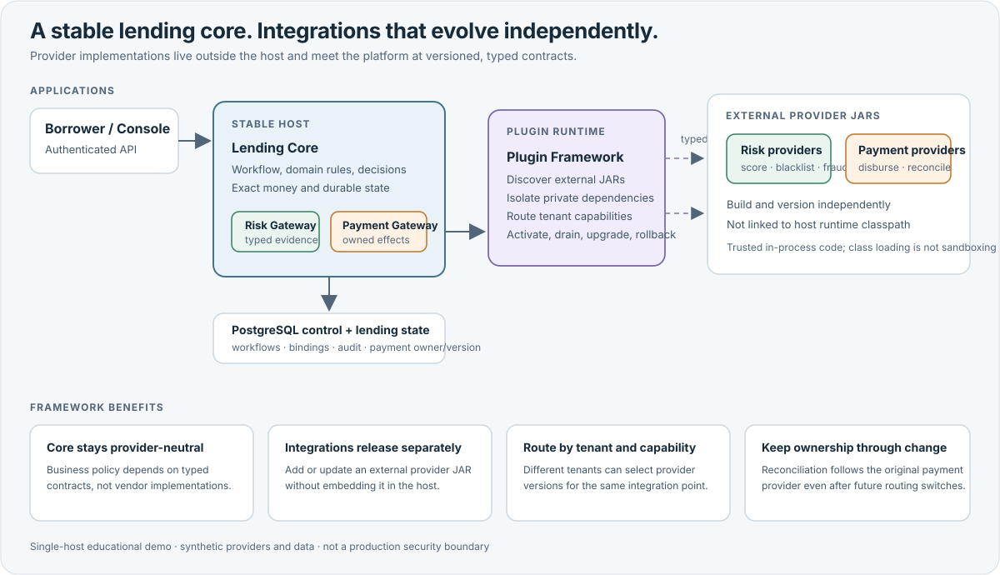

# FinBridge

**One Core. Multiple Providers. Zero Core Changes.**

FinBridge is an educational, synthetic lending-platform demonstration built around an external-provider plugin framework. A stable lending core calls independently packaged risk and payment providers through a typed SPI. The runtime discovers provider JARs, isolates provider-private dependencies, routes capabilities by tenant, and manages activation, draining, upgrades, and rollback without linking concrete providers into the host.



The framework keeps business policy in the core while provider implementations evolve independently. Add or upgrade a compatible provider at the integration boundary rather than embedding provider-specific code in lending workflows. Persisted payment ownership keeps reconciliation tied to the provider version that began the operation, even when future tenant routing changes.

**Why the plugin design matters:**

- **Keep the core provider-neutral:** typed SPI contracts separate lending decisions and workflows from provider implementations.
- **Evolve integrations independently:** providers are assembled as external JARs and are absent from the host runtime classpath.
- **Route by tenant and capability:** different tenants can bind risk or payment capabilities to different provider versions.
- **Manage change safely:** lifecycle controls drain invocations and support upgrade/rollback; unresolved payment work retains its original provider owner.

See [Create a Synthetic Provider](docs/guides/create-provider.md), [Plugin Lifecycle](docs/architecture/04-plugin-lifecycle.md), and [Tenant Routing](docs/architecture/10-multi-tenant-routing.md) for implementation details.

This is not a production lending, underwriting, identity, or payment system. All applicants, tenants, decisions, transactions, and providers are synthetic. Plugin class-loader isolation is not a sandbox: plugins execute as trusted code in the host process. The runtime is designed for one host process. Do not use real customer data, credentials, or provider integrations.

## What It Demonstrates

- A modular Java 21 application with a stable lending core and provider-neutral SPI.
- External plugin JAR discovery, class-loader isolation, tenant capability routing, lifecycle operations, and rollback.
- Durable application, risk, origination, repayment, and disbursement workflows backed by PostgreSQL.
- Exact decimal amounts, idempotent application/payment claims, immutable payment-provider ownership, and reconciliation of ambiguous outcomes.
- A local React Console and Spring API secured by Keycloak OIDC Authorization Code + PKCE, server-side sessions, CSRF protection, and server-side issuer/subject-to-tenant membership mapping.
- Synthetic borrower and administrator journeys runnable with Docker Compose.

## Quick Start

### Requirements

- JDK 21
- Docker with Docker Compose
- Node.js and npm for frontend checks and the optional HTTP E2E suite
- OpenSSL for generating a local-only TLS certificate

Build and run the Java quality gates:

```sh
./mvnw --batch-mode --no-transfer-progress clean verify
```

Start the local demo:

```sh
./deploy/generate-local-tls.sh
docker compose config --quiet
docker compose up -d --build
docker compose ps
```

Trust the generated `deploy/tls/localhost.crt` in your local browser/OS trust store, then open <https://localhost:8443/borrower>. The certificate and its private key are local development fixtures and must not be used elsewhere.

Use the [local demo guide](docs/guides/borrower-demo-usage.md) for seeded synthetic accounts and the full borrower/admin walkthrough. Borrower pages are scoped to the signed-in synthetic applicant; internal Console views are tenant-wide. Tenant identity and borrower ownership are derived on the server, not from caller-selected request fields.

Stop the stack and preserve its local data with:

```sh
docker compose down
```

The demo uses seeded local-only passwords and a default local database password. They are public fixtures, not secrets suitable for reuse. Never expose this stack to an untrusted network. Compose binds demo services to localhost. To intentionally discard all synthetic database data and volumes, use `docker compose down -v`.

## Run Checks

Java checks run from the repository root with JDK 21:

```sh
./mvnw --batch-mode --no-transfer-progress clean verify
```

Frontend checks run from `frontend/`:

```sh
npm ci
npm run build
npm test
npm audit --omit=dev
```

The audit command checks production dependencies only. The authenticated live HTTP suite targets the local Compose stack and deliberately disables Node TLS verification for its generated self-signed certificate. Run it only against that isolated local demo:

```sh
FINBRIDGE_DEMO_ALLOW_INSECURE_TLS=true npm run test:e2e
```

See [Testing and Evidence](docs/guides/testing-and-evidence.md) for scope and evidence boundaries.

## Architecture and Guides

- [FinBridge Through a Domain-Driven Design Lens](docs/architecture/domain-driven-design.md)
- [System overview](docs/architecture/01-system-overview.md)
- [Lending domain model](docs/architecture/02-lending-domain-model.md)
- [SPI contract design](docs/architecture/02-spi-contract-design.md)
- [Plugin class-loader isolation](docs/architecture/03-classloader-isolation.md)
- [Origination workflow](docs/architecture/03-loan-origination-workflow.md)
- [Risk gateway](docs/architecture/04-risk-decision-and-data-gateway.md)
- [Plugin lifecycle](docs/architecture/04-plugin-lifecycle.md)
- [Payment and disbursement](docs/architecture/05-payment-gateway-and-disbursement.md)
- [Repayment plans](docs/architecture/06-repayment-plan-design.md)
- [Tenant routing](docs/architecture/10-multi-tenant-routing.md)
- [Transaction consistency](docs/architecture/11-transaction-consistency.md)
- [Security, reliability, and observability](docs/architecture/12-security-reliability-observability.md)
    - [Production evolution and limitations](docs/architecture/13-production-evolution.md)
- [Getting started](docs/guides/getting-started.md)
- [Create a provider](docs/guides/create-provider.md)
- [Plugin lifecycle operations](docs/guides/plugin-lifecycle-operations.md)
- [Local borrower demo and default tenant capability bindings](docs/guides/borrower-demo-usage.md)
- [Demo walkthroughs](docs/demos/)
- [Portfolio case study and demo screenshots](docs/portfolio/case-study.md)
- [Architecture decision records](docs/adr/README.md)

The active design baseline is [M0 proposal v2](docs/architecture/m0-proposal-v2.md), together with accepted ADRs. [M0 proposal v1](docs/architecture/m0-proposal.md) is superseded historical material. Experimental M0 spikes are isolated under `m0-spikes/` and are not product modules.

## Project Status and Limitations

The repository includes implementation milestones M1-M6 and the approved M7 local authenticated demo layer. The demo and its identity configuration are for local evaluation only. It demonstrates selected hardened web controls but is not production-ready or a production security recommendation. Production identity selection, deployment hardening, secrets management, multi-host guarantees, real risk underwriting, and real payment settlement are out of scope. See the [security architecture](docs/architecture/12-security-reliability-observability.md), [local demo threat model](docs/security/threat-model.md), [production evolution notes](docs/architecture/13-production-evolution.md), and [portfolio case study](docs/portfolio/case-study.md) for limits and evidence.

## License

This project is distributed under the MIT License. See [LICENSE](LICENSE). Third-party dependencies and assets remain subject to their own licenses.
