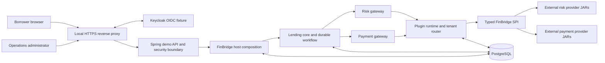
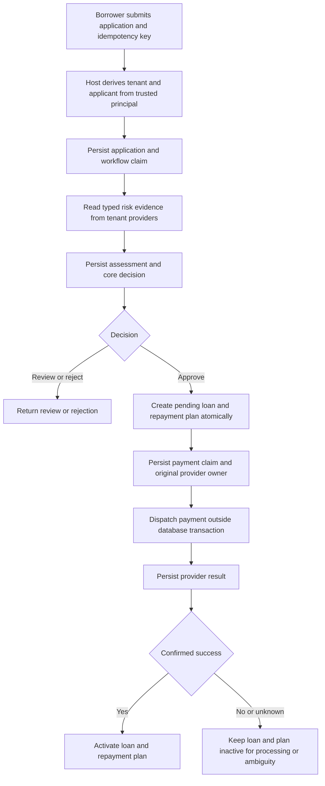

# FinBridge Platform Specification

This document is the current, reader-facing specification for FinBridge. It explains the platform as implemented and separates demonstrated behavior from non-goals. Individual accepted decisions are recorded in [Architecture Decision Records](../adr/README.md); verification evidence is recorded in the [architecture review checklist](../quality/architecture-review-checklist.md).

## Purpose and Scope

FinBridge is an educational lending-platform demonstration built around an external-provider plugin framework. It demonstrates how a stable lending core can use independently packaged risk and payment providers through a typed Java SPI, while retaining ownership of lending policy, workflow state, payment ownership, and tenant authorization. The codebase is a single platform; historical implementation stages are not editions or runtime components.

The runnable local platform includes a synthetic borrower journey, an operations/admin Console, Spring API, PostgreSQL, a local OIDC provider, an HTTPS reverse proxy, and synthetic provider artifacts. All applicants, tenants, products, risk results, decisions, payments, credentials, and provider responses are synthetic.

FinBridge is not a production lending, underwriting, identity, or payment system. It does not claim legal loan terms, validated credit policy, real settlement, regulatory compliance, or production security certification.

## Design Goals

- Keep lending decisions and workflow rules independent of provider implementations.
- Load trusted provider artifacts separately from the host runtime classpath.
- Route provider capabilities by authenticated tenant and retain the selected provider version for work already started.
- Persist workflow and payment intent so safe recovery can distinguish repeatable reads from ambiguous side effects.
- Activate a loan only after its disbursement is durably confirmed successful.
- Make the synthetic deployment, checks, and limits reproducible for repository users.

## System Context



The system is a **modular monolith**, not a set of independently deployed domain services. Maven modules define source and dependency boundaries inside one host process. PostgreSQL stores durable lending, workflow, payment, plugin registry, binding, and audit records. Runtime handles, active class loaders, invocation leases, and the published routing snapshot are process-local and single-host.

PostgreSQL is the implemented persistence technology. ADR-011 is still marked proposed in its own record; that status has not been silently changed as part of this documentation refactor. See [ADR-011](../adr/ADR-011-postgresql-persistence.md) and its status in the [ADR index](../adr/README.md).

## Modules and Dependency Direction

| Module or area | Responsibility |
|---|---|
| `finbridge-spi` | Framework-neutral typed provider contracts, identifiers, capabilities, requests, and results. |
| `finbridge-plugin-runtime` | Artifact validation/discovery, per-artifact class loading, registry, invocation leases, and in-memory routing. |
| `finbridge-risk-gateway` | Risk capability calls, bounded execution, result normalization, and synthetic decision policy. |
| `finbridge-payment-gateway` | Provider-neutral disbursement calls and status reconciliation. |
| `finbridge-lending-core` | Applications, risk assessments, loans, repayment schedules, workflow, payment claims, and PostgreSQL persistence. |
| `finbridge-host` | Composition, trusted principal checks, tenant/admin facades, plugin control plane, recovery, and Console adapters. |
| `finbridge-demo-app` | Runnable Spring API, local OIDC/session integration, and demo-only identity mapping. |
| `plugins/*` | Independently packaged synthetic risk/payment provider JARs. They are not host runtime dependencies. |
| `frontend/` | React Console and synthetic borrower experience. |
| `integration-tests/` | Test-only architecture and packaging checks. |

Providers depend on the shared SPI. Gateways and runtime depend on the SPI. Lending policy depends on gateway abstractions, not concrete providers. The host composes the platform. The Maven parent aggregates modules for builds but does not make every module a runtime dependency.

## Core Domain Invariants

1. Tenant identity comes from a trusted server-side principal, never from a caller-selected tenant field.
2. Risk providers return typed evidence; the lending core owns the decision.
3. Only an approved application may originate a loan, and an application has at most one loan/repayment plan.
4. Money uses exact decimal arithmetic (`BigDecimal`), not binary floating point.
5. Loan and repayment plan remain pending until confirmed successful disbursement is persisted.
6. External provider calls occur outside local database transactions.
7. Payment intent records an idempotency identity and immutable provider ID/version before dispatch.
8. An ambiguous payment outcome is reconciled with its original provider. It is not blindly resubmitted or failed over.
9. Changing a tenant binding changes future routing; it cannot change the owner of an existing payment.
10. A database desired-state row does not prove that a provider is loaded or active in memory.

## Business Flow



Risk, origination, and payment are separate durable steps. Risk reads may be repeated after interruption because the included providers are read-only synthetic fixtures. A payment with an unknown outcome is not safely repeatable; recovery queries the original owner. This is a local recovery model, not a distributed workflow engine.

## Plugin Framework

A provider is a trusted external JAR identified by plugin ID/version and artifact checksum. Its descriptor declares SPI version, provider type, and capabilities. Java service discovery locates the implementation. The runtime validates the archive and descriptor, initializes and health-checks the provider on bounded lifecycle worker pools, and registers it before activation.

Each artifact version receives a class loader. Java platform classes and the shared SPI are parent-first; provider implementation and private dependencies are child-first with parent fallback. This isolates dependency identity, not security. Plugins execute in-process with host privileges. A timed-out callback is quarantined, but a callback that ignores interruption may continue on a daemon worker. Untrusted plugins require a separate process boundary, which is not implemented.

The lifecycle is explicit: install/load, activate, bind to a tenant capability, drain, and unload. Binding revisions are persisted before the new in-memory route is published. An invocation lease pins a selected handle for the duration of a call. Unload is blocked while bindings, active calls, or unresolved payment ownership retain the artifact.

## Persistence and Failure Semantics

PostgreSQL and Flyway provide the durable store. Short local transactions protect application idempotency, workflow claims, atomic loan/plan origination, payment claims, binding revisions, and confirmed-success activation. Provider calls are outside these transactions.

The host cannot guarantee exactly-once effects across a database and an external provider. Idempotency and immutable ownership prevent unsafe host-side duplicate dispatch. `UNKNOWN` means that the host cannot establish whether an effect occurred; the safe action is status query against the original provider. Automatic retry/failover after ambiguity or definitive failure is not implemented.

Startup recovery is single-host. It verifies artifact files and checksums before restoring active routes or retained payment owners. Missing or changed artifacts fail closed rather than silently substituting another version.

## Local Identity and Trust Boundary

The local demo uses Keycloak OIDC Authorization Code + PKCE, a server-side session/BFF, CSRF protection, secure cookies, and issuer/subject-to-membership mapping. The server creates a trusted `FinBridgePrincipal`; borrower/applicant ownership and tenant scope are checked server-side. Plugin administration requires the demo admin role.

These are local demonstration controls, not a production identity recommendation or completed production threat assessment. Seeded credentials, database defaults, generated TLS keys, and synthetic records are local fixtures. Never expose the stack or use real customer data/credentials.

## Deployment and Reproduction

Prerequisites: JDK 21, Docker Compose, Node.js/npm for frontend checks and optional E2E, and OpenSSL for a local TLS certificate.

```sh
./mvnw --batch-mode --no-transfer-progress clean verify
./deploy/generate-local-tls.sh
docker compose config --quiet
docker compose up -d --build
docker compose ps
```

Open `https://localhost:8443/borrower` after trusting the generated local certificate. See the [README](../../README.md), [getting-started guide](../guides/getting-started.md), and [borrower demo guide](../guides/borrower-demo-usage.md) for demo accounts, workflows, and shutdown instructions. `docker compose down` preserves local data; `docker compose down -v` deliberately discards synthetic volumes.

## Verification and Evidence

The release evidence is commit [`30d28e15034a580db8ec10661d739037378aa45f`](https://github.com/chen3862000-coder/finbridge/commit/30d28e15034a580db8ec10661d739037378aa45f), verified by [GitHub Actions run 41049982380](https://github.com/chen3862000-coder/finbridge/actions/runs/41049982380). The Java, frontend, and clean Compose authenticated-E2E jobs passed. The [architecture review checklist](../quality/architecture-review-checklist.md) contains exact evidence, quality-gate results, traceability, and limitations.

## Explicit Non-Goals

- Real underwriting, customer data, credit bureaus, payment rails, settlement, ledger/accounting, or regulatory compliance.
- Production identity, key/secret operations, public deployment hardening, or production security certification.
- Arbitrary/untrusted plugin execution, plugin sandboxing, forced thread termination, or signed-artifact supply-chain attestation.
- Multi-host orchestration, distributed locking/fencing, shared sessions, or exactly-once external effects.
- Automatic retry or provider failover for unknown or failed payment outcomes.
- A separate microservice for each Maven module or DDD boundary.

## Decision Records

The detailed context, alternatives, consequences, and status of individual decisions are recorded in [Architecture Decision Records](../adr/README.md). ADR status remains authoritative. This specification summarizes the current platform and does not silently convert a proposed ADR into an accepted decision. If an ADR's status conflicts with implemented code or the ADR index, treat it as a documentation issue to resolve explicitly rather than infer approval.
