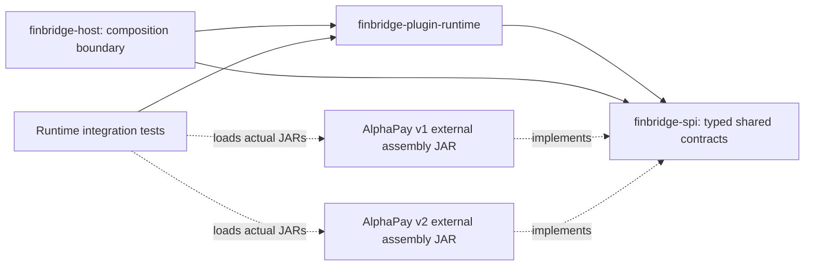

# System Overview: M1 Plugin Foundation

**Status:** Implemented scope through M1 only. The Lending Core and loan workflow remain planned for M2+.

FinBridge is being built as a Java 21 Maven modular monolith. The plugin foundation establishes a JDK-only typed SPI, a host-side runtime, an empty host composition boundary, and provider artifacts distributed outside the host. The core value demonstrated in M1 is that `ServiceLoader` discovery, class-loader policy, lifecycle management, and tenant binding are separate concerns with executable evidence.

The Maven parent aggregates the modules for reproducible builds. Reactor aggregation does not imply a runtime dependency. Provider implementations depend on the SPI as `provided` and package their provider-private helper in the plugin assembly. The host depends on SPI/runtime only. Runtime state (class loaders, leases, and bindings) is currently in-memory; PostgreSQL persistence and authenticated tenant context are not part of M1. Integration tests use the Maven-built plugin artifacts as test dependencies, but create a parent test loader that cannot load provider classes or service resources before the runtime opens the external plugin JARs.

## M1 Invariants and Evidence

| Claim | Implementation | Executable evidence | Limit |
|---|---|---|---|
| SPI has no Spring dependency and is typed | `finbridge-spi/src/main/java/io/github/finbridge/spi/**` | `PluginContractsTest` | API is still version 1 proposal surface; semantic compatibility requires future contract tests. |
| Discover external providers using Java SPI | `PluginDiscovery.discover`, provider `META-INF/services` resources | `PluginRuntimeIntegrationTest.loadsRealExternalPluginJarsWithSharedSpiAndPrivateDependencyIsolation` | Same-process integration test; not a public install API or host restart demo. |
| Isolate provider-private dependencies | `PluginClassLoader`; AlphaPay assembly artifacts | Integration test checks distinct helper class and defining loader, shared SPI loader | Class-loader separation is not a sandbox. |
| Keep providers off host runtime package/classpath | Host depends on runtime/SPI; provider dependencies are test-scoped in runtime or test artifact scope elsewhere | `ArchitectureBoundaryTest`, `HostPackagingTest` | Host is a minimal composition library, not yet the runnable Spring application. |
| Route and pin an in-memory tenant capability | `PluginBindingRegistry`, `PluginInvocationLease` | `bindingUpdatesAreOptimisticAndRoutingPinsSelectedHandle` | Not persisted or authenticated; no multi-host guarantees. |
| Drain/unload follows lease and retention checks | `PluginHandle`, `PluginRuntime.drain/unload` | `drainingBlocksNewBusinessAndHonorsBindingsAndOwnerRetention`, `drainWaitsForLeasesAndUnloadClosesPluginResources` | M1 uses a retention policy callback; payment store will supply the durable ownership decision in M4. |

## Deferred Scope

Loan applications, assessments, risk policy, loans, repayment plans, database adapters/migrations, transaction ownership, authorization, observability, and Console are not implemented. See the active [M0 v2 proposal](m0-proposal-v2.md) and its milestone gates.
