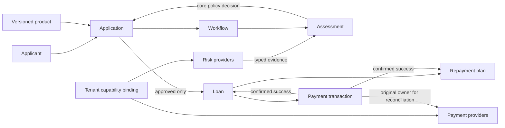

# Domain-Driven Design

This guide explains the business language and consistency boundaries in FinBridge. FinBridge is a modular monolith; the contexts below are conceptual responsibility boundaries, not independently deployed services.

## Domain Flow

## Contexts

| Context | Owns |
|---|---|
| Lending | Product terms, applications, risk assessments, lending decisions, loans, repayment schedules. |
| Origination workflow | Durable step/attempt progress across risk, loan creation, and disbursement. |
| Provider integration | SPI contracts, artifact identity, provider lifecycle, invocation leases, tenant capability routes. |
| Tenant/operator access | Trusted principal, borrower membership, tenant scoping, admin-only controls. |
| Persistence consistency | Unique claims, optimistic revisions, local transactions, durable payment owner. |

## Ubiquitous Language

- **Application:** Tenant-owned request. It is not a loan.
- **Risk data:** Typed evidence from an integration. It is not an approval.
- **Risk assessment:** Persisted evidence plus the core-owned decision, reason codes, and policy version.
- **Loan:** Obligation originated from one approved application. It begins pending disbursement.
- **Repayment plan:** Calculated schedule that is not active and has no due dates until disbursement succeeds.
- **Payment transaction:** Durable intent/outcome pinned to the provider version that accepted dispatch.
- **Capability binding:** Tenant's current provider selection for future calls to one capability.
- **Unknown payment:** Outcome cannot be established; query the original provider, do not resubmit/fail over.

Application idempotency, one-loan-per-application, immutable payment ownership, exact decimal amounts, and success-gated activation are enforced at service and persistence boundaries. See [Lending Domain](07-lending-domain.md), [Workflow](08-origination-workflow.md), and [Payment](10-payment-disbursement.md).
