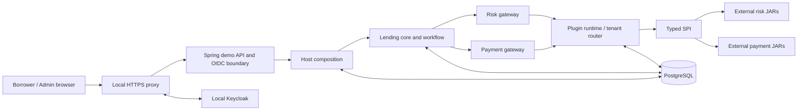

# System Architecture

FinBridge is a Java 21 modular monolith. Maven modules isolate compile-time responsibilities, but the runnable host is one process backed by PostgreSQL. Provider JARs are distributed separately and loaded into the process by the plugin runtime.

## Module Responsibilities

- `finbridge-spi`: framework-neutral contracts and shared data types.
- `finbridge-plugin-runtime`: discovery, validation, class loading, registry, leases, and in-memory routing.
- `finbridge-risk-gateway` / `finbridge-payment-gateway`: provider adapters and typed outcomes.
- `finbridge-lending-core`: lending domain, workflow services, and persistence.
- `finbridge-host`: authorization, plugin control plane, recovery, Console adapters, and composition.
- `finbridge-demo-app`: runnable local HTTP/OIDC configuration.
- `plugins/*`: synthetic provider artifacts; omitted from host runtime classpath.
- `frontend/`: React Console and borrower demo.
- `integration-tests/`: test-only packaging and architecture evidence.

The dependency direction is inward: provider implementations depend on SPI; gateways/runtime consume SPI; Lending Core does not import provider implementations; the host composes the modules. This is not a microservice deployment.

## Runtime Topology and Limits

Compose runs PostgreSQL, Keycloak, API, Console, and Nginx on a local Docker network. Nginx exposes the browser-facing HTTPS endpoint on loopback. Providers are trusted in-process Java code; class-loader isolation is not a sandbox. Runtime routing, leases, recovery, and sessions are single-host. See [Platform Specification](01-platform-spec.md), [Tenant Routing](12-tenant-routing.md), and [Security](14-security-reliability.md).
