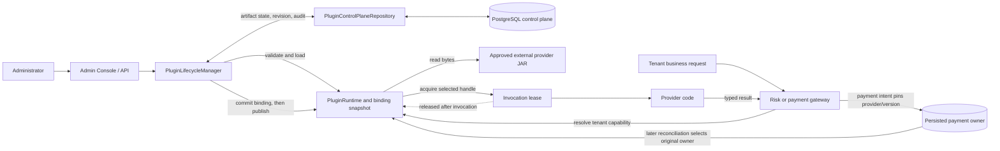

# Plugin Lifecycle

FinBridge treats a provider as a versioned external artifact with a managed runtime, not as a library permanently linked into the lending application. Lifecycle management controls when a provider may receive work, how tenant routes move between versions, and when its resources may be closed.

This guide describes the implemented single-host design and its current operational limits. Providers are trusted Java code running inside the host process. A separate class loader isolates dependency identity; it is not a security sandbox.

## Lifecycle at a Glance

```mermaid
stateDiagram-v2
    [*] --> DISCOVERED: artifact selected from approved directory
    DISCOVERED --> VALIDATED: archive, descriptor, SPI and capabilities pass
    VALIDATED --> LOADED: initialize and health check pass; handle registered
    LOADED --> ACTIVE: administrator activates
    LOADED --> UNLOADED: discard without activation
    ACTIVE --> DRAINING: stop new business routing
    DRAINING --> ACTIVE: resume only when no invocation leases remain
    DRAINING --> UNLOADED: no bindings or retained work; leases drained; close succeeds
    DRAINING --> FAILED: provider close fails
    UNLOADED --> [*]

```

`DISCOVERED` and `VALIDATED` are install milestones recorded with the lifecycle history after successful registration; they are not independently routable states. Install validation, initialization, or health failures stop installation before a normal handle is registered. The durable control plane does not claim that a Java class loader is alive: after a restart, the runtime must recreate and validate a provider before restoring its routes.

## How Lifecycle and Requests Fit Together

The host commits a tenant binding revision in PostgreSQL before publishing the new in-memory route. A gateway resolves that route when a new invocation starts and obtains a lease on the selected version. Reconciliation is different: it consults the payment's persisted owner rather than the tenant's current route.

## Installing an Artifact

Installation begins with a prebuilt filename inside a configured, approved plugin directory. The host does not provide arbitrary filesystem access or browser-based JAR upload. The runtime validates the file and archive, computes its SHA-256, checks the SPI service declaration and descriptor, verifies the provider type and capabilities, and creates a per-artifact class loader. It then constructs the provider, calls `initialize`, checks health, and registers a `LOADED` handle.

The provider identity is `(pluginId, pluginVersion)`. The control plane also records the artifact filename, checksum, type, capabilities, desired state, and lifecycle audit. Registering the same identity with different bytes is rejected. Installation does not make the provider routable; activation is a separate operation.

The SPI lifecycle callbacks are `FinBridgePlugin.initialize`, `healthCheck`, and `close`. They run on dedicated bounded daemon executors with a per-callback deadline. Initialization/health and close use separate pools so stalled startup checks cannot consume all close workers. Saturation is rejected immediately. Timed-out handles are quarantined as `FAILED`; the runtime requests interruption and closes the artifact loader when it is safe to do so.

## Activating and Routing

An administrator explicitly activates a loaded provider. Activation makes it eligible for tenant capability bindings; it does not itself assign any tenant to the plugin.

A binding selects one active provider version for a `(tenant, capability)` pair, such as `DEMO_ALPHA + CREDIT_SCORE -> creditscorex 1.0.0`. The control plane commits the binding with an optimistic revision before the host publishes its in-memory routing snapshot. New calls resolve the tenant's current binding and acquire an invocation lease on that provider handle.

The lifecycle states and the durable desired state are related but are not the same:

| In-process runtime state | Meaning | Durable control-plane intent |
|---|---|---|
| `LOADED` | Provider validated and initialized; no business calls accepted | Usually `LOADED` |
| `ACTIVE` | New routed calls and reconciliation calls may acquire leases | `ACTIVE` |
| `DRAINING` | New business calls are rejected; payment reconciliation may still use the owner | Usually being retired or replaced |
| `UNLOADED` | Provider was closed, loader was closed, and handle removed | `RETIRED` or no longer present in runtime |
| `FAILED` | A lifecycle operation failed; do not assume the provider is usable | Audit/state depends on the operation that failed |

The database stores desired artifact state and audit history. Runtime state, class loaders, active leases, and the published binding snapshot are process-local. A database row is not evidence that a provider is currently loaded or healthy.

## Draining and Unloading

Draining is the handoff period between accepting new work and releasing provider resources:

1. Stop routing new business invocations to the old provider by changing/removing its bindings.
2. Keep the provider available for reconciliation when it owns unresolved payments.
3. Wait for in-flight invocation leases to finish.
4. Confirm there are no remaining tenant bindings or payment-owner references.
5. Call the provider's `close` hook, close its class loader, and remove the runtime handle.

The timeout passed to drain/unload bounds the wait for invocation leases. Lifecycle callbacks have a separate configured deadline. A plugin that ignores interruption can continue running on its daemon worker after the caller times out; Java cannot safely force arbitrary in-process code to stop. The handle is quarantined and is not returned to routing. Stronger isolation and forcible termination require process boundaries and are outside this design.

Unloading is refused while the provider is still bound, has active invocation leases, or owns unresolved payment work. `DRAINING` rejects new business work but permits reconciliation calls so the original payment owner can resolve an ambiguous result.

## Upgrade and Rollback

An upgrade installs and validates a new artifact, activates it, commits a new tenant binding revision, publishes that route, and then drains the previous provider when it has no other references. Rollback changes the future route to a previously registered version using another revision. It does not rewrite payment history.

Each payment transaction records the provider identity/version that accepted its dispatch. Even after an upgrade or rollback, reconciliation queries that original owner. This ownership rule is why an otherwise unused provider may remain loaded until unresolved payments are resolved.

## Startup Restoration

At startup, the host reads persisted artifacts that are active or still own unresolved payment work. For each artifact it:

1. Confirms the approved artifact file is present.
2. Loads and validates the artifact using the current runtime.
3. Compares its checksum, type, and capabilities to the persisted identity.
4. Activates the runtime handle when appropriate.
5. Restores tenant bindings only after their target provider has been restored and verified.

Missing or changed artifacts fail closed and produce lifecycle audit events; the host does not silently substitute another provider version. A retired provider retained for unresolved payment work is restored in a draining state so it can service reconciliation without accepting new business routes.

## Failure and Recovery Semantics

- Artifact validation, initialization, or health-check failure prevents normal registration/activation. Cleanup is attempted and the failure is surfaced/audited.
- A binding update is revision-checked. A stale revision is rejected rather than overwriting a concurrent administrator's change.
- A blocked drain leaves the provider available in its current draining state for reconciliation or later retry; it is not unloaded while references remain.
- A close failure marks the runtime handle failed and is surfaced to the lifecycle caller. The host must not treat a failed close as a successful unload.
- Startup restoration verifies immutable artifact identity before publishing routes.
- Lifecycle controls and restoration are single-host. There is no distributed fencing or coordination between multiple runtime processes.

## Operating the Local Demo

The local demo's optional `DemoPluginBootstrap` installs the configured fixture artifacts, activates them, and fills missing default tenant capability bindings at startup. Compose enables this bootstrap; `application.yml` defaults it off. Bootstrap does not overwrite existing bindings. The [Borrower Demo Usage guide](../guides/borrower-demo-usage.md#demo-tenant-capability-bindings) lists the mappings and shows how to inspect effective routes.

For manual lifecycle operations, sign in with the synthetic administrator at `/console` and use **Plugin Registry** and **Tenant Routing**. Only active providers advertising the selected capability can be bound. Use the displayed expected revision when committing a route. The [Plugin Lifecycle Operations guide](../guides/plugin-lifecycle-operations.md) covers the operator flow and checksum behavior.

## Security and Deployment Limits

- The artifact directory is an allowlist boundary for trusted local artifacts, not a remote upload interface.
- Provider code executes with the host process's privileges. Do not load untrusted JARs.
- Class-loader isolation separates provider-private dependency versions; it does not isolate memory, CPU, filesystem, network access, or credentials.
- Runtime lifecycle state, invocation leases, recovery, and routing publication are single-process/single-host.
- Callback workers are bounded and separated for initialization/health versus close. Saturation fails fast. Timeouts quarantine the provider, but interruption cannot forcibly stop arbitrary in-process code.
- This is a local synthetic demonstration, not a production plugin deployment procedure.

## Further Reading

- [Typed SPI contracts](02-spi-contract-design.md)
- [Class-loader isolation](03-classloader-isolation.md)
- [Tenant routing](10-multi-tenant-routing.md)
- [Transaction consistency](11-transaction-consistency.md)
- [Create a synthetic provider](../guides/create-provider.md)
- [Plugin lifecycle operations](../guides/plugin-lifecycle-operations.md)

## Evidence

- `PluginRuntimeValidationTest` covers artifact validation, descriptors, and binding constraints.
- `PluginRuntimeIntegrationTest` loads real provider JARs and covers lifecycle, routing, drain, retention, and unload behavior.
- `PluginLifecycleManagerTest` and `PluginControlPlaneIntegrationTest` cover durable lifecycle controls and optimistic binding revisions.
- `PluginRecoveryRunnerTest` covers startup recovery behavior.

These tests establish the tested single-host behavior. They do not establish sandboxing, forced termination of arbitrary provider code, or multi-host lifecycle coordination.
