# Plugin Lifecycle

Lifecycle management controls when a provider may receive work, how tenant routes move between versions, and when resources can be released. A provider is an external, versioned JAR, not a library permanently linked to the host.

```mermaid
stateDiagram-v2
  [*] --> DISCOVERED: selected from approved directory
  DISCOVERED --> VALIDATED: archive, descriptor and SPI pass
  VALIDATED --> LOADED: initialize and health pass
  LOADED --> ACTIVE: administrator activates
  LOADED --> UNLOADED: discard
  ACTIVE --> DRAINING: stop new business routing
  DRAINING --> ACTIVE: safe resume
  DRAINING --> UNLOADED: no references; leases drained; close succeeds
  DRAINING --> FAILED: close fails or callback times out
  UNLOADED --> [*]
```

`DISCOVERED` and `VALIDATED` are transient install stages. Durable artifact desired state/audit is distinct from process-local state, class loaders, leases, and routing snapshot. A database row does not prove a provider is loaded or healthy after restart.

## Install, Route, Drain

1. Select an allowlisted local artifact. The runtime validates archive, checksum, SPI service declaration, descriptor, type, and capabilities.
2. Initialize and health-check on bounded worker pools; register as `LOADED` only on success.
3. An administrator activates the provider. Activation alone does not route a tenant.
4. Persist a revision-checked `(tenant, capability) -> provider version` binding, then publish the in-memory route.
5. New calls acquire an invocation lease. Payment reconciliation selects the persisted original payment owner instead of the current route.
6. Drain blocks new business calls but permits retained payment reconciliation. Unload requires no bindings, in-flight leases, or retained payment ownership.

Init/health and close callbacks run on separate fixed-size, no-queue daemon pools with per-callback deadlines. Saturation fails fast. A timeout quarantines the handle as `FAILED` and requests interruption. Non-cooperative in-process code may continue; Java cannot force-stop it safely. This is not a sandbox or production deployment procedure.

Startup restoration verifies checksums before publishing routes. Missing or changed artifacts fail closed. See the [operator guide](../guides/plugin-lifecycle-operations.md), [demo bindings guide](../guides/borrower-demo-usage.md#demo-tenant-capability-bindings), [SPI contracts](04-spi-contracts.md), [class-loader isolation](05-classloader-isolation.md), and [tenant routing](12-tenant-routing.md).
