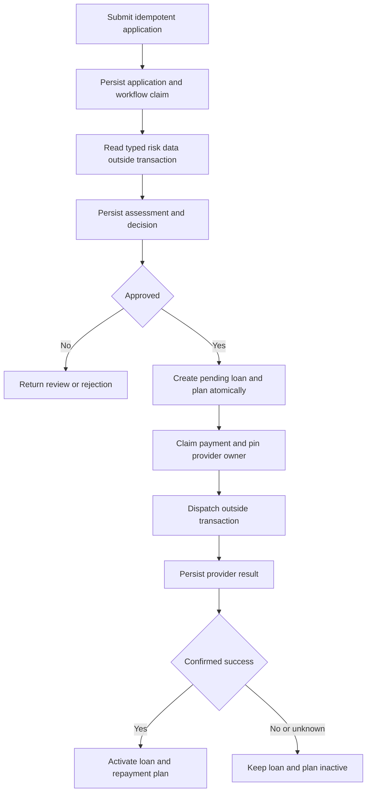

# Origination Workflow

The origination workflow is a PostgreSQL-backed state machine, not one long transaction or a distributed workflow service. Each step reserves durable identity before external calls and commits local state in short transactions.

Completed risk assessments replay from persistence. Interrupted risk reads may be repeated because included risk providers are read-only fixtures. Loan origination is unique per application and atomic. Payment ambiguity follows query-only recovery against the original provider. Startup recovery and in-memory routing are single-host; there is no distributed fencing. See [Transaction Consistency](13-transaction-consistency.md).
