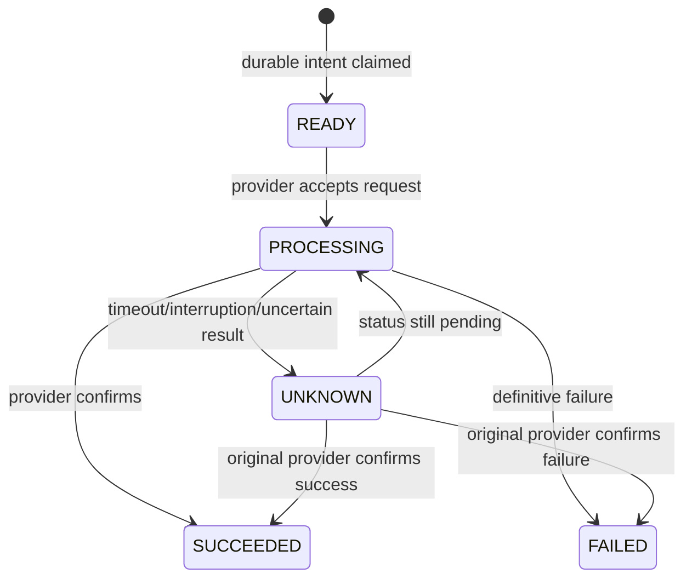

# Payment and Disbursement

Before a provider call, the host claims a durable payment transaction containing the idempotency key, request fingerprint, attempt identity, and immutable provider ID/version. The call runs outside a database transaction. A matching replay does not redispatch; conflicting payload reuse is rejected.

Only persisted confirmed success activates the loan and repayment plan and assigns due dates, in one local transaction. `UNKNOWN` is neither failure nor success: query the original owner using provider transaction ID or host transaction/idempotency references. Never blindly resubmit, fail over, or change historical owner. Definitive failure is terminal in this demo; retry-intent policy is not implemented. This does not guarantee exactly-once settlement. See [ADR-007](../adr/ADR-007-payment-transaction-ownership.md), [ADR-009](../adr/ADR-009-loan-activation-after-disbursement.md), and [Transaction Consistency](13-transaction-consistency.md).
