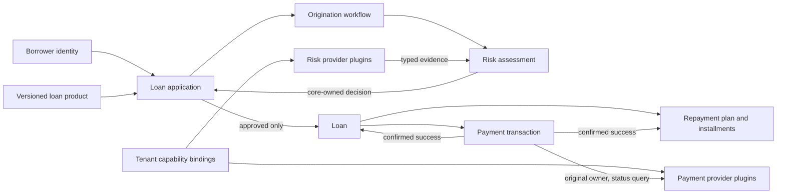

# FinBridge Through a Domain-Driven Design Lens

This guide explains FinBridge as a domain model: the business concepts it represents, the boundaries between them, the rules that keep them consistent, and the role of the provider plugin framework. It is an orientation document for readers, not a code review or an additional architecture proposal.

FinBridge is an educational, synthetic lending-platform demonstration. Its risk decisions and payment effects are fixtures, not real underwriting or settlement. The runtime assumes one host process and trusted in-process plugins; class-loader isolation is not a security sandbox.

## The Domain in One Picture

The central business journey is application to risk decision to loan origination to payment-confirmed activation. Risk and payment providers supply replaceable capabilities, but the lending domain owns the meaning of their results.

## Bounded Contexts and Responsibilities

FinBridge is deployed as a modular monolith, not as a collection of independently deployed domain services. The modules below describe responsibility and language boundaries inside one application. A Maven module boundary does not by itself imply a separate bounded context or deployment.

| Context | Responsibility | Owns these concepts |
|---|---|---|
| Lending | Defines application eligibility, the synthetic risk decision, loan origination, and repayment terms | Loan product, loan application, risk assessment, loan, repayment plan, installment |
| Origination workflow | Records progress across risk, origination, and disbursement so interrupted work can resume safely | Workflow state, step/attempt identity, assessment and payment references |
| Provider integration | Adapts replaceable provider capabilities to typed contracts and controls provider lifecycle | SPI contracts, provider artifact identity, plugin handle, tenant capability binding, invocation lease |
| Tenant and operator access | Establishes the trusted actor and limits borrower, tenant-console, and administrator operations | FinBridge principal, borrower membership, tenant scope, admin authority |
| Persistence and consistency | Stores durable domain state and enforces local uniqueness, revisions, and transaction boundaries | PostgreSQL rows, idempotency claims, optimistic versions, durable payment ownership |

These are conceptual boundaries, not claims that every item is an independently deployable service. The lending core owns domain decisions; gateways and plugins are supporting integration mechanisms.

## Ubiquitous Language

- **Loan product:** A versioned set of supported currency, principal limits, term choices, and interest terms. An application records the product version used when it was submitted, so later product changes do not silently rewrite an existing request.
- **Loan application:** A tenant-owned request from one synthetic applicant. It records the requested amount and terms and moves through its own lifecycle. It is not a loan.
- **Risk data:** Typed evidence such as a credit score, blacklist result, or fraud signal returned by a provider. Evidence is not a decision.
- **Risk assessment:** A persisted snapshot that combines normalized evidence, provider execution references, a lending-core decision, reason codes, and the policy version used.
- **Decision:** The lending core's synthetic `APPROVE`, `REJECT`, or `REVIEW` result. An approval permits origination; it does not disburse money or activate a loan.
- **Loan:** The originated obligation, linked to one approved application. It begins pending disbursement.
- **Repayment plan:** The calculated principal-and-interest schedule for a loan. Amounts can be calculated before disbursement; due dates and active status follow confirmed disbursement.
- **Payment transaction:** A durable record of an intended external payment, its idempotency identity, its outcome, and the provider version that owns it.
- **Capability binding:** A tenant's selected provider for a capability, such as credit-score lookup or disbursement. It controls future routing, not historical payment ownership.
- **Unknown payment outcome:** The host cannot prove whether the external operation happened. It is neither success nor definitive failure and requires a status query to the original provider.

## Aggregate and State Boundaries

An aggregate is a consistency boundary: its invariants are checked when state changes. FinBridge intentionally separates records whose lifecycles and consistency requirements differ.

### Application and Product Snapshot

`LoanApplication` owns its request identity, tenant/applicant relationship, requested amount and terms, selected product version, status, and optimistic version. Its state graph prevents arbitrary jumps. A risk result maps to `APPROVED`, `REJECTED`, or `MANUAL_REVIEW`; only an approved application may enter origination.

`LoanProduct` is versioned configuration. Application creation validates against the active version and persists that version on the application. Origination later loads that exact version rather than using whichever terms happen to be current.

Application idempotency prevents an identical request key from creating duplicate applications and rejects reuse of that key for a conflicting request. Tenant-scoped reads are enforced at persistence and host boundaries.

### Risk Assessment and Workflow

`RiskAssessment` is its own persisted decision record, rather than fields folded into the application. It records normalized facts and the policy/provider references needed to explain the synthetic result. Provider implementations provide evidence only; the core-owned policy decides what the evidence means.

`OriginationWorkflow` records progress across multiple local operations. It reserves workflow and assessment identity before risk calls, so recovery can resume a known step. A completed assessment is replayed from persistence rather than fetched again. The workflow is not a distributed workflow engine: recovery and runtime coordination are single-host.

### Loan, Repayment Plan, and Installments

An approved application can produce at most one loan. Origination writes the loan, pending repayment plan, installments, application transition, and relevant workflow state atomically in PostgreSQL. A duplicate origination returns the existing result rather than creating a second obligation.

The repayment plan contains ordered installment values. Monetary calculations use `BigDecimal`, the documented rounding convention, and a final-installment residual adjustment so scheduled principal reconciles exactly. The plan begins pending activation without due dates. Due dates are anchored to the actual disbursement date, including month-end clamping.

### Payment Transaction Ownership

A payment transaction is a separate consistency concept from both the loan and the tenant's current provider route. Before the provider call, the system persists an idempotency claim, request fingerprint, attempt identity, and immutable provider key/version. The external call occurs outside a database transaction.

If the provider confirms success, the result is persisted before activation. In one local transaction, the loan and repayment plan are activated and installment due dates are assigned. If the result is ambiguous, the payment remains unresolved. Recovery queries status through the original provider using its transaction reference or the host's transaction/idempotency pair. It does not blindly submit again or fail over to a different provider.

This distinction protects a historical fact: changing a tenant's binding changes which provider receives future work, but cannot transfer an existing payment transaction to another provider.

## The Plugin Framework as a Domain Supporting Capability

The plugin framework makes risk and payment implementations replaceable without moving lending policy into those implementations.

1. The stable SPI defines typed contracts for risk evidence and payment operations without Spring, persistence, or web types.
2. A provider is built as an external JAR with a descriptor and Java service declaration. Its private dependencies stay with that artifact rather than on the host classpath.
3. The plugin runtime validates and loads the artifact, establishes its lifecycle, and issues invocation leases.
4. Tenant capability bindings select an active provider for new calls. Risk and new payment dispatch are routed using the trusted tenant identity.
5. Payment reconciliation bypasses current routing and calls the persisted original owner. Lifecycle retention prevents unloading a provider while a binding, invocation, or unresolved payment still requires it.

From a DDD perspective, providers are not authorities over the lending model. A risk plugin returns evidence, not an application status. A payment plugin returns a typed operation status, not a loan lifecycle transition. Gateways translate these integration results into the domain's vocabulary, while lending services persist the resulting decisions and transitions.

The runtime uses per-artifact class loaders to isolate private dependency versions while sharing the parent-loaded SPI types. This is dependency isolation only. Provider code executes in-process and must be trusted.

## Important Business Flows

### Application and Decision

1. An authenticated borrower submits a product, amount, currency, term, and idempotency key.
2. The host derives tenant and borrower identity from its trusted server-side principal; the request cannot choose them.
3. The lending context validates terms against a versioned product and persists the application.
4. The workflow reserves a risk assessment before querying the tenant-bound risk providers.
5. The core normalizes evidence, applies the synthetic policy, persists the assessment and reason codes, and transitions the application.
6. Only `APPROVED` applications may continue to origination. Review and rejection do not create loans.

### Origination and Disbursement

1. Origination atomically creates one pending loan and a pending repayment plan for the approved application.
2. A payment request claims durable transaction identity and provider ownership before invoking the provider.
3. A confirmed success is persisted and atomically activates both the loan and plan.
4. A definitive failure stays failed. An unknown result stays unresolved and is reconciled with the original provider.

### Provider Upgrade and Routing Change

1. An administrator installs and validates an allowlisted provider artifact.
2. Activation makes it eligible for new bindings; a revision-checked binding update changes future routing for a tenant capability.
3. The old provider drains after it is no longer bound and has no in-flight invocation or retained payment ownership.
4. A rollback changes future routing back to a prior version. Existing payment transactions remain owned by the version that accepted their dispatch.

## Security and Tenant Scope in the Domain Model

Tenant identity is established outside the lending domain by the authenticated host boundary. The local demo validates an OIDC identity and maps its issuer/subject to a server-owned membership, then creates a trusted `FinBridgePrincipal`. Lending facades derive tenant scope from that principal rather than accepting a caller-selected tenant identifier.

Borrower access adds applicant ownership checks within a tenant. Internal tenant-console views may be tenant-wide, while borrower reads and actions are scoped to that borrower's fixed server-side applicant reference. Plugin lifecycle and routing controls require administrator authority.

These boundaries describe the local demonstration. They do not constitute production identity selection, a threat model, multi-host authorization guarantees, or a sandbox for plugins.

## What This Design Does Not Claim

- Real credit underwriting, regulatory compliance, or production loan terms.
- Real payment settlement, exactly-once external effects, or automatic retry of ambiguous payments.
- Arbitrary or untrusted provider execution safety; class loaders are not a sandbox.
- Multi-host orchestration, distributed locking/fencing, or a distributed transaction.
- A separate microservice for each conceptual context.

## Further Reading

- [System overview](01-system-overview.md)
- [Lending domain model](02-lending-domain-model.md)
- [Loan origination workflow](03-loan-origination-workflow.md)
- [Typed SPI contracts](02-spi-contract-design.md)
- [Risk decision and gateway](04-risk-decision-and-data-gateway.md)
- [Payment and disbursement](05-payment-gateway-and-disbursement.md)
- [Repayment plan calculation](06-repayment-plan-design.md)
- [Tenant routing](10-multi-tenant-routing.md)
- [Transaction consistency](11-transaction-consistency.md)
- [Create a synthetic provider](../guides/create-provider.md)
