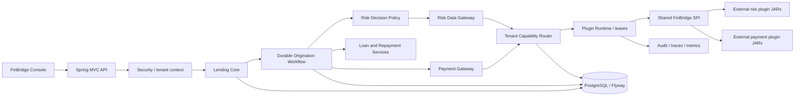
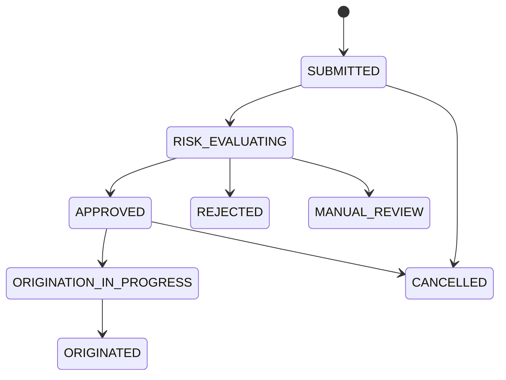
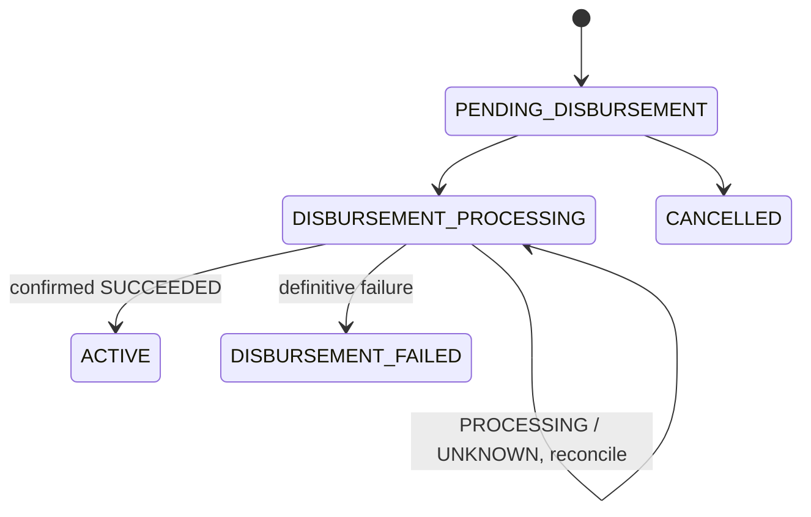
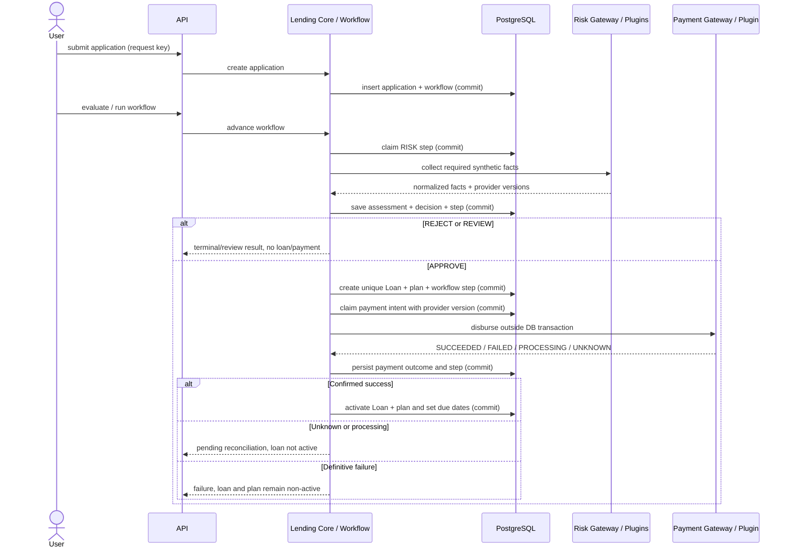

# FinBridge M0 Architecture Proposal v2.0

**Status:** Active approved design baseline for M1; remaining M0 policy choices are still open for M2 review.  
**Specification:** FinBridge Coding Agent Implementation Prompt v2.0  
**JDK:** Java 21, fixed requirement  
**Original scope:** M0 architecture redesign and bounded technical validation only. User subsequently authorized proceeding to M1. M2-M7 remain gated.  
**Principle:** One Stable Lending Core. Pluggable Risk and Payment Providers. Complete Loan Origination. Safe Runtime Evolution.

## 1. Executive Proposal

FinBridge v2 is a single-host modular lending application demonstrating a complete synthetic cash-loan lifecycle: application, risk-data retrieval, core-owned decision, loan and repayment-plan origination, payment disbursement, and activation only after confirmed payment success. Lending Core owns workflow and domain policy. Risk and Payment Gateways depend on typed, versioned SPI contracts and resolve provider versions through tenant capability bindings. Providers are independent external JARs loaded by a small explicit runtime.

Origination is a durable database-backed state machine, not one long database transaction and not a distributed workflow engine. Each step commits local state before/after external calls. Payment intent is uniquely claimed and pinned to a provider version before invocation. If a crash or timeout makes a side effect uncertain, it remains `UNKNOWN` and is reconciled through the original provider; the loan and repayment plan remain non-active until confirmed success.

All identities, products, applicants, provider data, decisions, and transactions are synthetic. This is an architecture demonstration, not a lending decision system or a production financial platform. It assumes one host process and trusted in-process plugins.

## 2. Repository and Environment Baseline

The repository was inspected before redesign. It began with a placeholder README and no source, Maven project, wrapper, UI, Compose stack, or implementation tests. The v1 proposal and ADRs remain in the repository as superseded design history; this v2 document is the active proposal.

| Check | Finding / decision |
|---|---|
| JDK | Microsoft OpenJDK 21.0.12.1 is installed. Maven 3.10.0 successfully starts when `JAVA_HOME` is set to it. JDK 21 is fixed for builds and deployment. |
| Default environment | The shell currently defaults to JDK 27; developer commands, Maven toolchain/configuration, CI, and containers must explicitly select Java 21. |
| Maven Wrapper | Not present yet; M0 build spike will add and verify a pinned wrapper. |
| Docker | Docker Compose CLI v5.6.0 and Docker daemon 29.9.1 are available; no project Compose stack exists or has been run. |
| Spring Boot | Proposed stable 3.5.x release on Java 21. Select and pin the exact supported patch during the build spike after checking its release/support status. |
| Plugin loading / class identity | No code existed when initially inspected. Results must be recorded from the M0 real-JAR spike below; no result is assumed. |

## 3. Scope, Non-Goals, and Invariants

### In scope

- One synthetic cash-loan product with configurable principal, 3/6/12 monthly installments, a fixed demo rate, and equal-payment amortization.
- Separate application, risk assessment, loan, repayment plan/installments, payment transaction, and durable workflow state.
- Core-owned deterministic risk policy consuming normalized risk provider data.
- Tenant-specific capability routing for risk and payment providers.
- SPI discovery, per-version class loaders, explicit lifecycle, draining, and safe historical provider ownership.
- Recoverable loan origination with idempotent steps, payment intent, reconciliation, and explicit UNKNOWN state.
- React Console with an end-to-end Workflow Explorer and architecture explanation.

### Non-goals

- Real applicants, credit bureaus, bank rails, payment networks, credentials, or provider payloads.
- Legal loan contracts, real underwriting, collections, accounting/ledger, taxation, or regulatory claims.
- General-purpose workflow platform, Temporal/Camunda/Kafka, multi-host control plane, or arbitrary public JAR execution.
- Exactly-once processing across the database/provider boundary, guaranteed process sandboxing, or deterministic class unloading.

### Core invariants

1. A tenant is taken from authenticated server context; every application, loan, payment, workflow, and execution read is tenant-scoped.
2. Risk data acquisition is a gateway concern; final `APPROVE/REJECT/REVIEW` policy belongs to Lending Core and stores policy version/reason codes.
3. Rejected, manual-review, or incompletely assessed applications cannot automatically originate an active loan.
4. At most one loan and one repayment plan are created for an application, enforced by database uniqueness as well as service idempotency.
5. Loan and repayment-plan creation are in one short local database transaction.
6. External plugin calls never occur inside a long database transaction.
7. A loan and repayment plan become `ACTIVE` only after a confirmed successful disbursement.
8. Unknown or processing payment is not failure and does not activate the loan.
9. Payment intent persists its exact provider ID/version before provider invocation; no binding change can alter that ownership.
10. Workflow retry advances/reconciles durable state; it cannot create a second loan, schedule, or payment submission.
11. Provider implementations are not host runtime dependencies; SPI class identity is shared by parent delegation.
12. Every advertised guarantee is linked to source and an executed test; no unsupported production guarantee is claimed.

## 4. Proposed Architecture and Module Graph



Proposed Maven dependency direction:

```text
finbridge-spi (JDK only)
  ^                ^
  |                +-- plugins/* (SPI only + private dependencies)
  +-- finbridge-plugin-runtime
  +-- finbridge-payment-gateway --+
  +-- finbridge-risk-gateway -----+--> finbridge-lending-core
                                    --> finbridge-host (composition/API/JDBC/Security)

integration-tests: test-only access to host/core/runtime and built external plugin JARs
```

Suggested modules: `finbridge-spi`, `finbridge-plugin-runtime`, `finbridge-payment-gateway`, `finbridge-risk-gateway`, `finbridge-lending-core`, `finbridge-host`, external `plugins/*`, and test-only `integration-tests`. Core domain/application code has no dependency on provider modules or provider response DTOs. The host composes services, security, JDBC persistence, API, and migrations. The parent POM aggregates and manages versions but is not a runtime library. Build providers in the reactor if convenient, but publish/copy them to a plugin distribution directory; do not bundle them into the host executable. Packaging inspection is a required test.

Use Spring Boot 3.5.x on Java 21 (exact patch pinned in M0), PostgreSQL 16, Flyway, Spring JDBC, Spring Security, Actuator/Micrometer, JUnit 5, Mockito for unit boundaries, and Testcontainers for database-backed integration tests. Maven Wrapper version and frontend versions/lockfile are M0 build-spike outputs. React, TypeScript, and Vite are kept in `frontend/` with a reproducible lockfile.

## 5. Lending Domain Model and Ownership

| Model | Responsibility and lifecycle | Key invariants |
|---|---|---|
| `LoanApplication` | Tenant-owned origination request: `SUBMITTED`, `RISK_EVALUATING`, `APPROVED`, `REJECTED`, `MANUAL_REVIEW`, `ORIGINATION_IN_PROGRESS`, `ORIGINATED`, `CANCELLED`. | Contains synthetic applicant reference and requested product/amount/currency/term. Optimistic version. No payment status folded into application status. |
| `RiskAssessment` | Persisted normalized evidence, provider execution references, policy version, decision/reason codes, start/completion times. | One assessment/run policy is explicit; provider facts do not directly set final lending decision. Missing mandatory data cannot silently approve. |
| `Loan` | Tenant-owned originated obligation: `PENDING_DISBURSEMENT`, `DISBURSEMENT_PROCESSING`, `ACTIVE`, `DISBURSEMENT_FAILED`, `CANCELLED`, `CLOSED`. | Unique application ID. `ACTIVE` requires confirmed successful disbursement and activation timestamp. |
| `RepaymentPlan` | Schedule aggregate: `DRAFT`, `PENDING_ACTIVATION`, `ACTIVE`, `CANCELLED`, `COMPLETED`. | Unique per loan in MVP. Created atomically with loan; activated only with loan. Due dates finalized at activation from actual disbursement date. |
| `RepaymentInstallment` | Ordered installment with due date, opening principal, principal, interest, total, remaining principal and status. | Unique `(plan_id, installment_number)`, monotonically ordered; principal reconciles to original principal, final remaining balance is zero. |
| `PaymentTransaction` | Disbursement or optional first-installment collection, with idempotency/fingerprint, provider ownership, provider transaction ID, normalized status. | Unique tenant/operation/idempotency key. Provider owner is immutable; historical queries never use current routing. |
| `OriginationWorkflow` / step | Durable process state, current step, attempts, version, next action, safe error, timestamps and correlation ID. | Transitions are compare-and-set/idempotent. External calls have durable intent and are bracketed by local commits. |
| `LoanProduct` | Synthetic terms, supported principal range, currency, allowed terms, annual rate, rounding and due-date policy version. | Product snapshot/version used for a specific application/schedule is persisted to avoid silently changing in-flight terms. |

Risk assessment is not just a mutable application flag. A loan is not the application. A schedule exists before payment but is not active. A payment transaction is independently recoverable and owns its provider version. Use UUID identities, `Instant` for events, `LocalDate` for due dates, `BigDecimal` for money/rates, and optimistic versions on mutable aggregates.

### Domain state views





The workflow may have `WAITING_FOR_RECONCILIATION` while the Loan remains `DISBURSEMENT_PROCESSING`; do not encode every orchestration detail in the Loan status.

## 6. Cash Product and Repayment Schedule

Initial product defaults are synthetic: CNY, demo principal range such as 1,000–50,000, terms of 3/6/12 months, fixed configurable annual rate such as 12%, one-time disbursement, and equal monthly installments. Product values and policy are versioned; they are not a real offer.

For principal `P`, monthly rate `r = annualRate / 12`, and `n` installments:

```text
payment = P * r * (1+r)^n / ((1+r)^n - 1)
zero-rate payment = P / n
```

**Approved M2 rule (user-confirmed 2026-10-26):** Use `BigDecimal` only, `MathContext.DECIMAL128` intermediates, currency scale 2, and `HALF_UP` monetary rounding. Round scheduled payment and each installment amount to cents. For each non-final installment, compute interest from opening principal times monthly rate, rounded to cents; principal is installment payment minus interest. The final installment is adjusted to remaining principal plus final interest so principal sums exactly to `P` and ending remaining principal is exactly zero. Reject negative amortization or non-positive terms; validate final amount and no negative balance. Independently sum principal, interest, and total; tests cover zero rate, rounding residual, supported terms, deterministic output, and invariants.

Generate installment principal/interest values before disbursement, but set due dates on successful activation, anchored to actual disbursement date: installment 1 is one calendar month later, subsequent dates are monthly anniversaries, clamped to month-end while retaining the original day anchor (e.g. Jan 31 -> Feb 28/29 -> Mar 31). This due-date policy was approved by the user on 2026-10-26. Plan remains `PENDING_ACTIVATION` until success. Activation and due-date finalization happen in one DB transaction with Loan activation. No scheduled dates become overdue while disbursement is unresolved.

## 7. Risk Data and Decision Boundary

Risk Gateway obtains `CREDIT_SCORE`, `BLACKLIST`, and `FRAUD_SIGNAL` using tenant bindings; the core consumes normalized typed evidence with provider ID/version per fact. CreditScoreX, BlacklistY, and FraudSignalZ return synthetic results. The gateway handles timeouts, invalid responses, unavailable capabilities, and partial results but does not decide lending eligibility.

Lending Core owns versioned deterministic policy and persisted reason codes. **User-approved synthetic policy for M3:** blacklist and credit score are mandatory; fraud signal is optional. Blacklist hit or CRITICAL fraud -> REJECT. Missing/invalid mandatory data -> REVIEW. Score below 600 -> REJECT; 600-679 -> REVIEW; 680+ with complete mandatory data and no disqualifier -> APPROVE. Provider timeout/exception is unavailable data, not a negative signal. A rejected/review application creates no loan, schedule, or payment. Risk policy is reproducible from stored normalized inputs and policy version; raw provider payloads are not needed. These thresholds are synthetic demonstration policy, not validated underwriting.

## 8. Durable Origination Workflow and Transaction Boundaries

Use a PostgreSQL-backed lightweight process manager/state machine; do not use a long transaction across the workflow or introduce an external orchestration engine. A service/API call can advance one or more safe steps synchronously, but persisted workflow state is authoritative and can be resumed by an explicit retry/reconcile operation or startup recovery worker. Each transition uses a short transaction and optimistic workflow version.



### Crash/retry behavior

| Crash boundary | Recovery behavior |
|---|---|
| After application/workflow creation | Resume at first incomplete step; unique request key prevents duplicate submission. |
| During/after risk provider call before assessment commit | Risk query may be repeated only if it is read-only synthetic data; execution attempt is separately traced and bounded. Persist no decision until normalized facts are committed. |
| After decision commit | Reuse persisted assessment/policy version; do not silently re-evaluate under a new policy. |
| During loan/plan creation | One local DB transaction and unique application constraint mean both commit or neither; retry reads existing result. |
| Before payment intent commit | No provider call has occurred; routing may be resolved and pinned when a payment intent is claimed. |
| After payment intent commit but before call | State can be `READY_TO_SUBMIT` only if host can prove call not started. A durable dispatch claim/attempt record is committed before call; crash after claim but before network invocation is conservatively UNKNOWN unless a stronger boundary proves otherwise. Do not switch provider. |
| After provider side effect but before response persistence | On host epoch recovery mark unresolved attempt UNKNOWN; query original plugin/version/provider reference/idempotency key. Never blind resubmit or route to current binding. |
| After success persisted but before loan activation | Recovery sees terminal SUCCEEDED and idempotently activates loan/plan; it does not call provider again. |
| During reconciliation | Persist reconciliation attempt and result; repeated status queries are read-only/idempotent and always use transaction owner. |

Workflow/payment statuses must separate `READY`, `SUBMISSION_IN_PROGRESS`, `PROCESSING`, `UNKNOWN`, `SUCCEEDED`, and definitive `FAILED` as needed. The exact transition graph and recovery worker cadence are M0 decisions. Provider-side idempotency is used where the synthetic contract supports it, but it does not create end-to-end exactly-once guarantees. The design borrows Saga-style forward recovery with durable step state; it does not initially implement an event outbox because there is no broker/event consumer. An outbox becomes appropriate if workflow advancement is made asynchronous or events must be delivered reliably to another process.

## 9. Payment Safety and Loan Activation

Before disbursement, one transaction writes a unique payment intent `(tenant_id, operation_type, idempotency_key)`, canonical request fingerprint, Loan/Application/Workflow references, exact plugin ID/version, and dispatch state. Commit, then call plugin outside the transaction under an invocation lease. Persist provider transaction ID and normalized result in a second short transaction. Same key/same payload returns existing status/result; same key/different payload conflicts. Concurrent originations are settled by DB uniqueness for one loan/application and one payment key.

`UNKNOWN`/`PROCESSING` never means failure and never permits a second provider selection. Reconciliation loads the plugin recorded on the transaction, including after tenant binding changes. A definitive failure may set Loan `DISBURSEMENT_FAILED`; it does not activate the schedule. Any permitted retry after a definitive failure must be a deliberate new payment intent with explicit business semantics, not an automatic replay; scope of such a retry is an open decision. Successful payment status is persisted before activation. Loan, plan, due dates, and application `ORIGINATED` transition are committed together where schema/aggregate boundaries allow; payment itself remains a prior committed external fact.

Status query returns persisted terminal status without calling provider. Unresolved transactions retain their plugin artifact and permit only owner-based reconciliation while plugin drains. No unload while outstanding owner-dependent transactions exist. This prevents wrong-provider queries, not external settlement uncertainty.

## 10. Tenant Routing, Plugin Runtime, and Class Loaders

Binding key: `(tenant_id, gateway_type, capability)` -> `(plugin_id, plugin_version)`, with optimistic `binding_version`, `updated_by`, and timestamps. Tenant comes from authenticated server context, never request body. An immutable routing snapshot handles reads; update uses DB compare-and-set and publishes a new snapshot. New invocation resolves snapshot, validates gateway/capability/ACTIVE state, and atomically acquires a handle lease before plugin code. In-flight calls retain that exact handle.

Plugin identity is `(pluginId, pluginVersion)`; provider code groups releases. Install validates canonical path beneath allowlisted directory, bounded regular JAR, SHA-256, protected package absence, descriptor/API compatibility, actual SPI service entries, provider type/capabilities, construction/init, and bounded health check. Install ends LOADED, not ACTIVE. Lifecycle is `DISCOVERED -> VALIDATED -> LOADED -> ACTIVE -> DRAINING -> UNLOADED`, plus `FAILED`; no persisted ACTIVE flag proves a loader exists after restart.

One closeable loader per immutable artifact version. Parent-first for Java/platform and shared SPI/protected API; controlled child-first for plugin implementation/private dependencies. Never child-load the SPI. Reject duplicate SPI packages in plugin JAR. Load providers using `ServiceLoader` with shared parent SPI Class objects; handle malformed descriptors, linkage and constructor failures per artifact. Set/restore TCCL around bounded plugin initialization/calls. Drain rejects new normal routing, waits for current leases, requires no binding or unresolved payment owner before unload; owner status reconciliation can be specially permitted during drain. Close provider resources/loader and clean registry references; GC and Metaspace reclamation remain nondeterministic. In-process plugins are trusted executable code, not sandboxed.

Dependency-isolation test must use two separately compiled plugin JARs containing incompatible private helper JAR versions with identical FQCN. Assert both execute, provider SPI identity equals host SPI class, private helper defining loaders differ. No simulation by strings/mocks.

## 11. Repayment and Workflow Persistence Schema

Proposed logical tables (exact fields/indexes follow the M0 spike/design review):

| Table | Core constraints and notes |
|---|---|
| `tenants` | Stable synthetic tenant ID, status, version. |
| `loan_products` | Product code/version, currency, bounds, allowed terms, annual rate, rounding/due-date rules, enabled flag. Persist product snapshot/version on application/loan. |
| `loan_applications` | Tenant/applicant synthetic reference, product version, requested amount `numeric`, currency, term, status, request idempotency/fingerprint, timestamps, optimistic version. Unique tenant/client application key. |
| `risk_assessments` | Application/tenant, status, normalized score/signals, decision, reason codes, policy version, provider execution refs (IDs/versions), times. No raw provider payload. |
| `loans` | Unique `application_id`, tenant, principal/rate/term/currency, product snapshot, status, payment transaction reference, lifecycle times, optimistic version. |
| `repayment_plans` | Unique loan, totals using `numeric`, installment count/status, created/activated timestamps, due-date policy/version. |
| `repayment_installments` | Plan FK, number, dates and all money columns `numeric`; unique `(plan_id, installment_number)`, principal/remaining invariants validated in service/tests. |
| `payment_transactions` | Tenant, loan/installment refs, operation, idempotency/fingerprint, amount/currency, immutable plugin ID/version, provider transaction ID, attempt/status/reconciliation fields, timestamps/revision. Unique `(tenant_id, operation_type, idempotency_key)`. |
| `origination_workflows` | Unique application, tenant, state/current step, optimistic revision, policy/product versions, correlation ID, timestamps and safe failure. |
| `origination_workflow_steps` | Workflow/step key unique; state, attempt count, execution reference, started/finished times, safe error/reason and retry/reconciliation action. |
| `plugin_artifacts` | `(plugin_id, plugin_version)` PK, provider code/type, SPI API version, SHA-256, artifact location/size and metadata. Same identity cannot be overwritten with different bytes. |
| `plugin_instances` | Durable desired configuration and last host epoch/observation only; actual loader state stays in memory. |
| `tenant_plugin_bindings` | Tenant/gateway/capability PK, artifact FK, binding revision, actor/time. |
| `plugin_execution_traces` | Tenant, workflow/step/execution/correlation IDs, operation, plugin/version, duration/status/error category. Bounded retention; no sensitive payload. |
| `plugin_lifecycle_events` | Append-only state transitions, artifact, actor, reason, host epoch, safe diagnostic. |

Use FKs for domain ownership, tenant IDs, product versions where retained, artifact ownership; indexes for tenant/status, workflow due/recovery scans, unresolved payment owner, due date, and correlation lookup. PostgreSQL `numeric` avoids binary floating-point for monetary storage; application arithmetic uses `BigDecimal`. Define delete/retention behavior explicitly; no cascade may erase an unresolved payment or its owner. Database uniqueness is the final concurrency authority. Host epoch marks recovery boundaries. With multiple hosts, leases, snapshots, lifecycle state, payment dispatch claims, and workflow workers require distributed coordination/fencing; this MVP does not support it.

## 12. API and User Experience Proposal

Keep the v2 endpoint groups: loan application create/list/detail/evaluate; originate and loan/list/detail/repayment plan; disburse/status/reconcile; risk assessment; plugin install/activate/drain/unload; tenant bindings; workflow/execution detail. A single `Run End-to-End Workflow` action calls the same domain/workflow services and shares the durable idempotency boundary; there must not be two routes that can bypass payment intent ownership. Avoid publicly accepting arbitrary artifact paths/JARs. Define whether application creation is idempotent by an idempotency header and whether `evaluate`/`originate` are commands or safe workflow-advance requests in M0 API review.

FinBridge Console pages: Dashboard; Loan Applications; Loan Details; Repayment Plan; Plugin Registry; Tenant Routing; Workflow Explorer; Architecture Explorer. Workflow Explorer displays step state/time/duration/entity/provider-version/reason/correlation and supports inspection. Tenant and admin authorization applies to API and UI. Responsive UI must make approval distinct from disbursement/activation, and display PROCESSING/UNKNOWN honestly.

## 13. Security and Observability

Roles: demo admin for allowlisted plugin install/lifecycle/binding actions; tenant user for own applications, loans, payment and workflow results. Verify tenant ownership on every boundary including traces, reconciliation, and detail endpoints. Do not trust a path/body tenant ID without principal authorization. No real secrets/data; no raw synthetic risk payload in traces if not needed. Allowlist local prebuilt plugin artifacts, canonicalize paths, enforce size/checksum, keep plugin directory non-web-writable. Class-loader isolation is not a sandbox.

Persist workflow step/audit and provider execution references with correlation IDs. Use structured logs, Micrometer, bounded metric labels (operation, gateway, outcome), and controlled Actuator exposure. Do not label metrics with tenant/application/payment IDs. Timeouts and stuck plugins are observable; interruption is cooperative, not a hard kill. Plugin execution context must restore TCCL.

## 14. Proposed v2 ADRs

These are proposals awaiting approval. The ADR set was revised for v2; the old v1 files are not separately archived. Treat the linked v2 ADRs as the active drafts.

| ADR | Proposed decision |
|---|---|
| [ADR-001](../adr/ADR-001-java-spi-vs-plugin-frameworks.md) | Java SPI plus explicit FinBridge runtime, no PF4J/OSGi for MVP. |
| [ADR-002](../adr/ADR-002-modular-monolith.md) | Modular monolith host with external provider artifacts. |
| [ADR-003](../adr/ADR-003-classloader-strategy.md) | Controlled per-version class loaders and shared SPI identity. |
| [ADR-004](../adr/ADR-004-typed-spi-contracts.md) | Typed/versioned SPI; no generic map operation. |
| [ADR-005](../adr/ADR-005-tenant-capability-routing.md) | Tenant/gateway/capability binding and invocation pinning. |
| [ADR-006](../adr/ADR-006-hot-swap-consistency.md) | Atomic future routing switch, in-flight lease, drain and owner retention. |
| [ADR-007](../adr/ADR-007-payment-transaction-ownership.md) | Immutable payment transaction ownership and reconciliation. |
| [ADR-008](../adr/ADR-008-durable-workflow-orchestration.md) | PostgreSQL-backed idempotent origination state machine, no distributed engine. |
| [ADR-009](../adr/ADR-009-loan-activation-after-disbursement.md) | Loan/plan activation only after persisted confirmed payment success. |
| [ADR-010](../adr/ADR-010-repayment-plan-generation.md) | BigDecimal amortization, explicit rounding and activation-date due dates. |
| [ADR-011](../adr/ADR-011-postgresql-persistence.md) | PostgreSQL/Flyway/JDBC for durable state in single-host MVP. |

Each ADR includes context, decision, alternatives, project-specific rationale, consequences, risks, and revisit conditions.

## 15. M0 Technical Validation Plan and Results

M0 requires minimal reproducible spikes, not product feature implementation. Spike sources/artifacts must be isolated under `m0-spikes/` and explicitly excluded from product modules. Record commands, JDK/vendor/version, Maven/Boot versions, and actual output. No fabricated results.

| Spike | Acceptance evidence | Status at proposal creation |
|---|---|---|
| Java 21 build | Wrapper reports Java 21; minimal Boot 3 host compiles/packages with pinned versions. | **PASS:** JDK 21.0.12.1, Maven Wrapper 3.9.11, Spring Boot 3.5.16; Maven Enforcer requires Java `[21,22)`; `clean package` succeeds. |
| Real external SPI JAR | Host/test harness loads separately built JAR through a loader and ServiceLoader descriptor, then calls provider without provider on host classpath. | **PASS:** isolated class-loader spike discovers and invokes both separately built provider JARs. |
| Dependency isolation | Two actual plugin JARs include conflicting helper versions/same FQCN; both execute; SPI class is shared; helper defining loaders differ. | **PASS:** helper-v1/helper-v2 behavior observed, shared `Provider` class is parent-defined, helper classes are defined by separate plugin loaders. |
| Malformed/protected plugin | Duplicate SPI package and invalid service descriptor rejected before activation; valid plugin remains loadable. | Pending execution. |
| Loan math spike | Pure calculation test/table for 0%, configured rate, term variants, month-end dates, final rounding; no application module yet. | **PASS for representative cases:** zero-rate 1,000/3 reconciles as 333.33, 333.33, 333.34; CNY 10,000 at 12%/12 gives rounded payment 888.49 and total interest 661.86; principal reconciles; Jan 31 anchor clamps to February end and returns to Mar 31. Broader property tests remain for M2. |
| Durable orchestration feasibility | Review/test PostgreSQL transaction/unique-key approach for one loan, workflow and payment claim; Testcontainers if daemon available. | Schema/design proposed; DB integration pending. |

M0 spike implementation and exact output are recorded in [`m0-spikes/RESULTS.md`](../../m0-spikes/RESULTS.md). M0 will not claim install-without-restart end-to-end API behavior, drain correctness, business workflow, or payment recovery unless actually built and tested. Full runtime lifecycle, tenant routing, concurrency, loan workflow, and payment behavior belong to M1+ acceptance tests.

## 16. Documentation and Evidence Plan

Current active documents: this v2 proposal and v2 ADRs. The old `m0-proposal.md` and v1 ADR design context are historical and superseded where they conflict. Planned architecture docs:

| Document | Target | Evidence requirement |
|---|---|---|
| `01-system-overview.md` | M1 | Context/component/deployment diagrams and actual module boundaries. |
| `02-lending-domain-model.md` | M2 | Entity, ownership, state, and uniqueness tests. |
| `03-loan-origination-workflow.md` | M4 | Sequence/state diagrams and crash/retry integration tests. |
| `04-risk-decision-and-data-gateway.md` | M3 | Actual policy/gateway classes and partial-failure tests. |
| `05-payment-gateway-and-disbursement.md` | M4 | Idempotency, UNKNOWN, owner and reconciliation evidence. |
| `06-repayment-plan-design.md` | M2 | Formula, rounding examples, due-date policy, executable tests. |
| `07-spi-contract-design.md` | M1 | Actual interfaces, descriptors, compatibility tests. |
| `08-classloader-isolation.md` | M1 | Real conflicting-JAR test output and known limits. |
| `09-plugin-lifecycle.md` | M1/M5 | Implemented state machine, lease/drain tests and recovery behavior. |
| `10-multi-tenant-routing.md` | M1/M5 | Binding schema, authorization and concurrent update tests. |
| `11-transaction-consistency.md` | M4 | DB boundaries, crash points, workflow/payment recovery tests; Saga/outbox comparison. |
| `12-security-reliability-observability.md` | M5 | Authorization tests, metrics/traces and bounded claims. |
| `13-production-evolution.md` | M7 | Explicitly separate implemented behavior from multi-node, signing, isolation and ledger proposals. |
| Guides and portfolio docs | M7 | Commands/screenshots/results actually verified; no fabricated metrics. |

Documentation quality gate: each claim references implementation class/module and executable test; states guarantee, limitations, and test result. Only run commands are documented as verified.

The coding-agent and build quality harness is specified in [`AGENTS.md`](../../AGENTS.md), [`docs/quality/quality-gates.md`](../quality/quality-gates.md), and [`architecture-review-checklist.md`](../quality/architecture-review-checklist.md). `pom.xml` configures blocking SpotBugs, PMD, Surefire, and JaCoCo gates; `.github/workflows/quality.yml` runs `./mvnw clean verify` on pushes and pull requests. Production modules run static analysis and coverage. The root aggregator has no source, and `integration-tests` is test-only (its Surefire tests run; production coverage is not applicable there).

The quality policy was confirmed by the user: SpotBugs (maintained FindBugs successor) plus PMD; blocking build/CI gates; 500 NCSS/class, 50 NCSS/method/constructor, cyclomatic complexity 10, cognitive complexity 15, and PMD design-smell rules; JaCoCo line coverage minimum 71% at bundle, production class, and concrete method levels. Test classes/generated code are excluded, not handwritten product code. The harness and review protocol are not a product milestone and do not authorize M1.

## 17. Milestones and Approval Gate

### M0 — Architecture Redesign and Technical Validation (completed)

- Review this v2 architecture, domain/state boundaries, workflow recovery, money math, plugin model, schema, APIs, and ADRs.
- Review the recorded Java 21/build, real JAR/class-loader, and amortization spike results; persistence/Testcontainers feasibility remains pending and must be completed or explicitly deferred at approval.
- Resolve open decisions and update v2 proposal/ADRs.
- M0 spike code remains separate from product modules. User authorized proceeding to M1 after reviewing the milestone plan; the open business-policy choices below remain for resolution before the relevant M2/M4 work.

### M1 — Plugin Foundation

- Implement SPI, runtime, ServiceLoader discovery, external provider packaging, class-loader isolation, lifecycle, routing foundation, compatibility, and runtime integration tests.
- Prove provider implementations are absent from host runtime package.

**M1 implementation status:** Implemented and verified in the current workspace. See `docs/architecture/01-system-overview.md` through `04-plugin-lifecycle.md` and the M1 review record in `docs/quality/architecture-review-checklist.md`. This completion does not authorize M2.

The full reactor uses an empty aggregator POM and a test-only integration module, so those modules have no production classes to analyze for JaCoCo. Surefire runs the integration architecture/package tests. Each production Java module runs SpotBugs/PMD, and JaCoCo enforces the configured module bundle/class/method threshold. The final `clean verify` passed with no missing-test or missing-coverage failures in production modules.

### M2 — Lending Core (completed)

- Implement application/product/risk assessment/loan/plan/installment domain; state machines; persistence; deterministic amortization; atomic loan-plan creation; unit/domain tests.

**M2 implementation status:** Completed and verified in the current workspace. Risk provider aggregation/decision execution remains M3; disbursement/workflow recovery remains M4. See `docs/architecture/02-lending-domain-model.md`, `docs/architecture/06-repayment-plan-design.md`, and the M2 review/traceability record in `docs/quality/architecture-review-checklist.md`.

M2 source and evidence are linked in `docs/architecture/02-lending-domain-model.md` and `docs/architecture/06-repayment-plan-design.md`, with the completed review record in `docs/quality/architecture-review-checklist.md`.

### M3 — Risk Integration, Approval, and Durable Risk-Step Recovery

- Implement risk gateway, CreditScoreX/BlacklistY/FraudSignalZ, normalization, tenant routing, deterministic core-owned policy, evidence persistence, and risk workflow tests.
- Persist origination workflow and risk-step attempt state. External risk reads remain outside DB transactions. Recovery can repeat this read-only risk step and persist the assessment/decision without duplicate application transitions using unique keys and optimistic versions. Disbursement/payment recovery remains M4.

**M3 implementation status:** Implemented in the current workspace; final root quality verification is pending. The synthetic risk policy and durable retry boundary are recorded as accepted ADR-012/013. See those ADRs and the M3 review/requirement traceability record in `docs/quality/architecture-review-checklist.md`. The policy is demonstration-only and not validated underwriting.

### M4 — Payment and Durable Disbursement Workflow

- Implement AlphaPay v1/v2 and BetaPay; payment transactions, idempotency, owner pinning, workflow persistence/recovery, disbursement/reconciliation, activation, crash/timeout/concurrency tests.

**M4 implementation status:** Implemented and verified in the current workspace. AlphaPay v1/v2 and BetaPay are external synthetic payment artifacts. Reconciliation supports the provider transaction ID or the client idempotency key paired with the persisted payment transaction ID. Ambiguous dispatch is query-only; automatic retry/failover is not supported. The full JDK 21 root `clean verify` passed; see accepted ADR-007, ADR-009, and the M4 review record in `docs/quality/architecture-review-checklist.md`. Host lifecycle wiring for unresolved-owner retention remains M5 work.

### M5 — Hot Swap, Security, and Observability

- Persist allowlisted artifact identity/checksum, desired active state, tenant capability bindings with optimistic revisions, and append-only lifecycle audit events. Restore active plugins and bindings on single-host startup after checksum verification.
- Enforce tenant operations through authenticated host service facades and admin-only plugin lifecycle/binding operations. The trusted principal is supplied by Spring Security; HTTP endpoints, credential issuance, external identity, and UI are not M5 scope.
- Implement safe upgrade/rollback by changing only future routing, draining and unloading only when no binding, invocation lease, or unresolved payment owner references an artifact. Wire M4 owner retention into the host lifecycle manager.
- Add explicit idempotent startup payment recovery: claimed-but-not-recorded dispatches become `UNKNOWN`; unresolved transactions are query-only through the original provider version. No blind resend, terminal-failure retry, multi-host fencing, or distributed worker guarantee.
- Add append-only lifecycle audit, Micrometer counters/timers and bounded observations without tenant/application/payment IDs in metric labels; add lifecycle, authorization, tenant isolation, restart recovery, and real PostgreSQL integration tests.

**M5 approved design baseline:** ADR-005, ADR-006, and ADR-008 accepted on 2026-10-27. The host remains a trusted single-process composition; local prebuilt artifacts are allowlisted, not uploaded, signed, or sandboxed. Binding publication and recovery are single-host only.

### M6 — FinBridge Console

- Implement dashboard, applications, loan detail, repayment plan, plugin registry, tenant routing, workflow explorer, and architecture explorer with responsive behavior.

### M7 — Documentation and Portfolio Release

- Complete all 13 architecture documents, 10+ ADRs, guides, six mandatory demos, README, portfolio case study, screenshots, Docker Compose, clean-clone verification, tests, and repository hygiene review.

Every milestone ends with functionality, files, decisions, database changes, tests/results, docs, limitations, risks, and next gate. No milestone is inferred complete from plans or interfaces alone.

### Required demonstrations

1. Complete successful cash-loan lifecycle through ACTIVE with persisted workflow steps.
2. Blacklist rejection with no loan, plan, or payment.
3. Tenant-specific risk/payment provider selections with unchanged core path.
4. Install FraudSignalZ externally and use it without host rebuild/restart.
5. AlphaPay v1->v2 upgrade/rollback preserving in-flight/historical ownership and avoiding duplicates.
6. Two conflicting private dependency versions loaded and invoked under separate plugin loaders.

Each demo needs a walkthrough, commands, expected results, test references, and actual execution evidence.

## 18. Open Decisions for Review

Please approve or change these before M1 (some should be decided before the M0 spike is finalized):

1. **Money rounding:** Accept final currency scale 2 and `HALF_UP`, with high-precision amortization intermediates and a final-installment residual adjustment?
2. **Due dates:** Accept due-date finalization at confirmed disbursement, monthly anniversaries with month-end clamping anchored to the original day?
3. **Risk policy:** Which mandatory evidence and synthetic score thresholds distinguish REJECT vs REVIEW vs APPROVE? Proposed safe rule: missing mandatory data -> REVIEW; only core policy decides.
4. **Workflow execution:** Accept database-backed state machine with explicit retry/reconcile and startup recovery; no Temporal/Camunda/Kafka? Is automatic background recovery required in MVP, or is an admin/API resume action sufficient initially?
5. **Payment retry after definitive failure:** Should a failed disbursement permit an explicit new intent/retry command, or remain terminal for MVP? Unknown outcomes will never be blindly resubmitted.
6. **Payment intent crash boundary:** Accept conservative UNKNOWN if process crashes after durable dispatch claim but before it is known whether the call was made?
7. **Application idempotency:** Require a client idempotency key for create application and define same-key/same-payload replay vs mismatch conflict?
8. **M0 boundary:** Allow isolated `m0-spikes/` code and build wrapper/config only, with all product module implementation after approval?
9. **Runtime topology/security:** Accept single-host trusted plugins and allowlisted local artifacts for MVP, with PostgreSQL 16?
10. **Spring baseline:** Accept stable Spring Boot 3.5.x, with exact patch pinned after current compatibility/support verification?
11. **Install API:** Keep arbitrary JAR upload disabled; admin selects an approved artifact in local plugin distribution?

## 19. Risks and Mitigations

| Risk | Impact | Mitigation / evidence |
|---|---|---|
| Uncertain provider side effect at crash | Duplicate or unactivated loan | Durable payment intent/owner, UNKNOWN state, owner-only reconciliation, no blind retries; crash-boundary tests. |
| Workflow DB says step claimed but call may not have started | Permanently uncertain operation | Treat post-dispatch claim as UNKNOWN unless provable pre-call boundary; record attempt and reconcile; explicit operator view. |
| Approval decision changes after retry/policy deployment | Non-reproducible origination | Persist policy version, normalized input evidence and decision; resume committed decision, never silently re-evaluate. |
| Rounding/due-date ambiguity | Different totals or schedule dates | Version product/calculation rules, BigDecimal, final residual, explicit date anchor; property/invariant tests and examples. |
| Loader leaks or non-cooperative plugin | Resource exhaustion / blocked unload | Lease tracking, bounded executor, cleanup hooks/TCCL restoration, timeout/quarantine; document thread interruption limits. |
| In-process plugin is malicious | Host compromise | Trusted allowlist only; class loader is not a sandbox; production untrusted code requires process isolation. |
| Binding publication/restart mismatch | Wrong provider or unavailable work | DB revision, immutable snapshot, host epoch reconciliation; single host only. |
| Scope inflation into loan platform | Delays and unclear demo | One product, no collections/accounting/real underwriting, milestones and hard MVP boundaries. |
| Unsupported architecture claims | Misleading portfolio | Evidence matrix, actual tests, proposal/implemented labels, no fabricated performance or production guarantees. |
| Toolchain drift | Non-reproducible build | Pin JDK 21 toolchain, wrapper, dependencies, frontend lockfile and image digests; CI/build evidence. |
