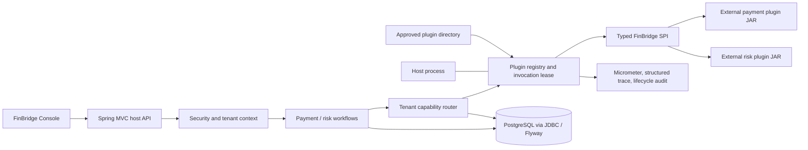
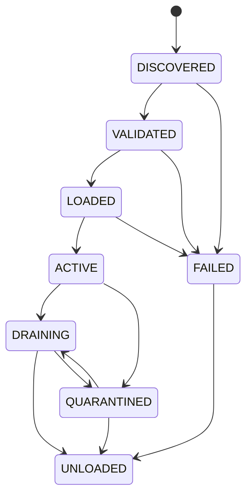

# FinBridge M0 Architecture Proposal (Superseded by v2)

**Status:** Superseded by [M0 Architecture Proposal v2](m0-proposal-v2.md) following the updated lending-platform scope. Retained for design history; do not use this version as the active implementation plan.  
**Scope:** Architecture and implementation plan only. No M1-M5 application implementation is authorized by this document.  
**Architecture principle:** Stable Core. Pluggable Integrations. Tenant-Specific Capabilities. Safe Runtime Evolution.

## 1. Executive Summary

FinBridge is a single-host, modular Java application that demonstrates how a stable lending workflow can call synthetic payment and risk providers through versioned typed contracts. Provider JARs are distributed separately from the host, discovered using Java SPI, and loaded into a dedicated class loader per artifact version. A runtime registry owns their lifecycle; PostgreSQL stores artifact metadata, tenant bindings, transaction ownership, and audit data. An invocation pins a provider handle before leaving routing, so routing changes affect later invocations but not work already in progress.

This is a trusted-plugin demonstration, not a security boundary or production payment system. The first release assumes one host process. It will not claim exactly-once settlement, deterministic class unloading, production credit decisions, or safe execution of arbitrary uploaded code.

## 2. Repository and Environment Findings

Inspection on 2026-10-26 found a clean `main` worktree containing only the initial commit and a placeholder README. No Maven project, wrapper, Java source, frontend, Docker Compose file, or existing implementation tests are present.

| Check | Finding |
|---|---|
| Installed JDKs | Microsoft OpenJDK 21.0.12.1 and OpenJDK 27 are installed. |
| Default toolchain | System Maven 3.10.0 currently starts on JDK 27. |
| JDK 21 compatibility check | Maven 3.10.0 successfully starts with `JAVA_HOME` set to the installed JDK 21. |
| Maven Wrapper | Not present; `./mvnw -version` could not run. |
| Docker Compose | `docker compose version` reports v5.6.0. This verifies the CLI only, not that the Docker daemon or a project stack works. |
| Spring Boot line | Maven Central metadata reports Spring Boot 3.5.16 as a stable 3.x release and Spring Boot 4.x releases separately. Proposed baseline: Boot 3.5.16, subject to checking its release notes and dependency support when the build is created. |
| SPI / class-loader proof | Not run. There is no project or plugin fixture to exercise. These remain explicit M0 spike acceptance criteria, not completed results. |

The exact Maven Wrapper, frontend package versions, PostgreSQL image, and Spring dependency set should be locked in the M0 build spike before M1. The stable Spring Boot 3.x line is preferred over a 4.x migration for this Java 21 demonstration; the precise patch selection must be rechecked against support status and JDK 21 compatibility at implementation time.

## 3. Goals, Boundaries, and Invariants

### Goals

- Keep lending workflows independent of provider implementation classes.
- Add and activate an approved provider artifact without rebuilding or restarting the host.
- Allow different tenants to route the same capability to different provider versions.
- Demonstrate private dependency isolation while preserving one shared SPI class identity.
- Make lifecycle transitions, payment idempotency, transaction ownership, and partial risk failure observable and testable.
- Provide documentation and reproducible evidence for each advertised guarantee.

### Explicit non-goals

- Real payment, settlement, credit bureau, customer, or secret-bearing integrations.
- An untrusted-code sandbox, distributed plugin control plane, or multi-host coordination.
- Exactly-once financial processing or automatic failover after an ambiguous payment result.
- Production credit-risk policy or claims that class unloading/Metaspace reclamation is deterministic.
- PF4J/OSGi adoption or a generalized extension framework beyond the two gateway domains.

### Invariants

1. The host runtime dependency graph contains no concrete provider implementation JARs.
2. Every plugin handle has one immutable `pluginId + pluginVersion`, artifact checksum, and class loader for its lifetime.
3. Plugin API types and DTOs are resolved from the host/shared parent, never duplicated in a plugin loader.
4. Every business invocation resolves the tenant on the server, verifies capability and eligibility, and pins a handle/lease before provider code runs.
5. A binding update changes future routing only; it never changes the provider selected for an in-flight call or persisted payment.
6. A payment with an ambiguous outcome is not retried against another provider.
7. No plugin is reported unloaded while invocation leases, tenant routes, or unresolved transaction ownership still require it.
8. Persisted desired state is not represented as proof that an in-memory plugin is loaded or active after restart.

## 4. Proposed System and Deployment Shape



The deployment is a local Docker Compose stack: PostgreSQL, one Spring Boot host, and a static React Console served by a lightweight web server or the host in the demo profile. Provider JARs are mounted/copied into a dedicated, non-web-writable plugin directory. Installation selects from approved local artifacts for the public demonstration; there is no arbitrary public JAR upload endpoint. The exact frontend serving arrangement is an M4 choice and should not complicate the host packaging.

The host is a modular monolith, not a set of network microservices. JDBC is the proposed persistence API because SQL transaction and locking boundaries are central to the demo and the required data access is bounded. Spring Security, Actuator, and Micrometer stay in the host layer, not in the SPI.

## 5. Maven Module Graph and Packaging

Proposed reactor modules:

```text
finbridge-spi
       ^
       +-- finbridge-plugin-runtime
       +-- finbridge-payment-gateway ----+
       +-- finbridge-risk-gateway -------+--> finbridge-host
       +-- plugins/* (SPI only)           |
                                          +--> integration-tests (test scope / fixtures)
```

More explicitly:

| Module | Compile dependencies | Responsibility |
|---|---|---|
| `finbridge-spi` | JDK only | Stable provider contracts, descriptors, typed requests/results, capability and error vocabulary. No Spring dependency. |
| `finbridge-plugin-runtime` | `finbridge-spi` | Artifact validation, controlled class loader, ServiceLoader discovery, compatibility validation, registry, lifecycle, leases. Framework-neutral core where practical. |
| `finbridge-payment-gateway` | SPI and runtime public API | Payment workflow, routing, idempotency, persistence ports/adapters, status reconciliation. No concrete providers. |
| `finbridge-risk-gateway` | SPI and runtime public API | Risk capability routing, normalization, aggregation, partial-failure policy. No concrete providers. |
| `finbridge-host` | Runtime, both gateways, Spring Boot, JDBC, Security, Actuator | Composition root, REST API, persistence adapters, migrations, identity, operations. Must not depend on provider modules. |
| `plugins/*` | `finbridge-spi` plus provider-private dependencies | Independent provider implementations and service descriptors. No Spring or host dependency. |
| `integration-tests` | Test-scoped host/runtime and built fixture artifacts | Real JAR/class-loader, lifecycle, database, and end-to-end architecture evidence. Not a production runtime dependency. |

The parent POM aggregates modules and manages versions but is not a runtime dependency. Providers may be built in the same reactor for reproducibility; their artifacts are copied to a plugin distribution directory, not shaded, copied into, or declared as runtime dependencies of the host. A packaging assertion must inspect the host artifact/dependency tree and prove provider classes/JARs are absent. Integration tests should construct or consume actual plugin JARs with `META-INF/services` entries and actual conflicting helper-library JARs.

Proposed implementation baseline: JDK release 21, Maven Wrapper pinned to a reviewed Maven 3.9.x release, Spring Boot 3.5.x stable patch, PostgreSQL 16, JUnit 5, Testcontainers, React 19, TypeScript, and Vite. Exact versions and container image digests are a build-spike output, not yet locked by this proposal.

## 6. SPI Contract Proposal

The SPI is a separately versioned library with a declared API major (initially `1`). Its public surface is intentionally synchronous and typed for the MVP. The host owns deadlines, invocation executors, tracing, routing, persistence, and normalization. No plugin receives Spring types, JDBC connections, web request objects, host services, arbitrary maps, or an unrestricted application context.

Proposed shape (illustrative signatures; the source API will be finalized in M1 after the spike):

```java
public interface FinBridgePlugin extends AutoCloseable {
    PluginDescriptor descriptor();
    default void initialize(PluginContext context) { }
    default PluginHealth healthCheck() { return PluginHealth.healthy(); }
    @Override default void close() { }
}

public interface PaymentProvider extends FinBridgePlugin {
    PaymentResult disburse(DisbursementRequest request, OperationContext context);
    PaymentResult collect(CollectionRequest request, OperationContext context);
    PaymentStatus queryStatus(PaymentTransactionRef transaction, OperationContext context);
}

public interface RiskDataProvider extends FinBridgePlugin {
    RiskDataType supportedType();
    RiskDataResult query(RiskDataRequest request, OperationContext context);
}
```

`PluginDescriptor` is immutable and includes `pluginId`, `providerCode`, `pluginVersion`, `spiApiVersion`, `pluginType`, supported capabilities, display name, and description. The durable artifact/instance key is `(plugin_id, plugin_version)`; `providerCode` groups a vendor/product line and is not a unique artifact identity. A SHA-256 checksum identifies exact bytes; conflicting bytes claiming the same identity are rejected rather than silently replaced.

Typed payment amounts use integer minor units plus an ISO currency code. A payment result distinguishes accepted/processing, succeeded, declined, and unknown/ambiguous outcomes and carries a provider transaction reference only where available. Provider errors map to a small normalized category set while preserving a sanitized provider code. Idempotency key and business request identity are explicit request data. `OperationContext` carries correlation/execution identity, a deadline, and cancellation signal; tenant identity is not used as a plugin authorization credential. Only the minimum synthetic tenant reference required by a fixture may be exposed.

Risk capability identifiers are stable enum/string values for `CREDIT_SCORE`, `BLACKLIST`, and `FRAUD_SIGNAL`. Risk result models distinguish unavailable/invalid data from a negative signal; absent data cannot be interpreted as safe. Contract evolution uses an explicit SPI major and host-supported compatibility range, descriptor validation, binary-compatibility checks, and compatibility fixtures. For API major 1, incompatible signature/semantic changes require a new major. Additive evolution is allowed only when old implementations remain binary- and behavior-compatible; default methods alone are not treated as proof of compatibility. Plugins are rejected before activation if SPI major, descriptor, service count/type, or declared capability implementation is invalid.

## 7. Class Loader and Discovery Design

Use one closeable `URLClassLoader`-based loader per immutable plugin artifact version, with a controlled `loadClass` policy:

- Parent-first for platform namespaces (`java.*`, `javax.*` where applicable), all `io.github.finbridge.spi.*`, and explicitly protected host API packages.
- Child-first for plugin implementation packages and approved private dependencies.
- Reject plugin artifacts that bundle protected SPI/host packages or attempt protected namespace shadowing.
- Keep Spring, host internals, and the mutable runtime registry out of the plugin-visible API.

Discovery runs `ServiceLoader.load(PaymentProvider.class, pluginLoader)` and/or the risk equivalent with the SPI `Class` object from the host parent. Discovery and construction run with the plugin thread context class loader set only for the bounded initialization call and restore the previous TCCL in `finally`. Handle `ServiceConfigurationError`, linkage errors, constructor failures, duplicate providers, and descriptor exceptions as artifact validation failures; one bad artifact must not prevent other artifacts from being discovered.

Class identity is the pair of binary class name and defining loader. Therefore each plugin must delegate SPI classes to the shared parent while defining its private helper dependencies itself. The isolation proof must compile two plugin artifacts against incompatible versions of a helper with the same fully qualified class name, package each helper version privately, load and call both, then assert: both results are correct, provider SPI class identity equals the host SPI class, and helper classes have distinct defining class loaders. It must use actual compiled artifacts, not a mock class name or string simulation.

Unloading removes registry and routing references, drains leases, closes plugin resources and URLClassLoader, shuts down plugin-owned executors/threads through lifecycle hooks, and restores TCCL. A `WeakReference` test may observe collectability under controlled conditions but must not assert deterministic GC or Metaspace reclamation. Plugins are trusted code in the same JVM: they can access process resources, exhaust CPU/memory, create unmanaged threads, or use reflection. Class-loader separation is dependency isolation, not a sandbox. Process/container isolation is required for untrusted extensions.

## 8. Runtime Lifecycle and Recovery

Proposed states:



Installation validates that a canonical path remains under the configured artifact root, the file is a bounded regular JAR, checksum and identity are recorded, protected packages are absent, SPI compatibility holds, service providers are discoverable, descriptors/capabilities agree, initialization succeeds, and an optional bounded health check passes. Installation ends in `LOADED`, not `ACTIVE`. Activation is a separate audited administrator action and is permitted only for a validated, initialized, healthy handle.

An invocation lease is acquired atomically with checking that the handle is eligible for that invocation class. Normal business routing cannot acquire a `DRAINING` handle. The lease captures the exact handle and increments in-flight accounting before provider execution. Binding changes publish an immutable routing snapshot for future resolutions; they do not mutate prior leases. Lease release occurs in `finally` even on provider failure or timeout.

Drain first prevents new ordinary routing to the plugin. The administrator must rebind or remove tenant capabilities before unload. Transaction-status reconciliation is a separate ownership-based invocation class: it may use a draining provider to resolve a transaction the provider already owns, but it cannot submit a new disbursement/collection. Unload waits for ordinary leases and reconciliation to finish, no tenant binding to refer to the plugin, and no unresolved payment record to require its status-query capability. Terminal transaction status is served from the persisted canonical record; a provider call is required only while reconciliation remains unresolved. A bounded drain timeout leaves the plugin `DRAINING`/observable and blocks unload; it does not falsely claim success. Quarantine blocks ordinary routing immediately and records why.

Persist artifact identity/checksum, desired administrative state, lifecycle events, and configuration; treat actual loader and lifecycle state as process memory. At startup, all persisted active intentions begin as not loaded; the host scans the approved artifact store, revalidates checksums and compatibility, loads approved artifacts into a non-active state, then reconciles bindings. It does not silently activate merely because a database row says `ACTIVE`. A payment left `IN_PROGRESS` by a prior host epoch is conservatively changed to `UNKNOWN`/reconciliation-required: the host cannot prove whether provider code performed a side effect. A demo bootstrap profile may explicitly activate preapproved sample plugins and seed bindings, with that behavior clearly separated from production recovery.

## 9. Tenant Routing and Concurrency

Bindings are keyed by `(tenant_id, gateway_type, capability)` and point to `(plugin_id, plugin_version)`. Each row has a monotonically increasing `binding_version`/optimistic-lock revision, `updated_at`, and `updated_by`. One operation chooses its capability, reads the authenticated server-side tenant principal, obtains a consistent binding snapshot, checks plugin type/capability/active eligibility, and acquires a plugin lease before calling out. The request body cannot establish or override the tenant identity.

For the single-host MVP, the database is the durable configuration authority and an in-memory immutable routing snapshot is the read path. A binding update uses compare-and-set/optimistic locking in a database transaction. After commit, the host atomically publishes the new snapshot; a failed publication is retried/reconciled from the database and surfaced as an operational error. Lifecycle activation/drain and binding validation share a short control-plane coordination boundary, not a global lock around business calls. The invocation lease closes the race between route lookup and drain. Multi-process cache invalidation/coordination is explicitly out of scope.

For a bulk tenant binding replacement, the API must use an expected revision/ETag and reject stale writes with a conflict response. For a single binding, row-level optimistic locking prevents silent overwrite. Every routing update and lifecycle transition is audited. When a plugin starts draining, it is immediately ineligible for new ordinary invocations even if stale durable bindings still reference it; those requests fail with an explicit unavailable-binding response until rebind/rollback completes.

## 10. Payment Consistency Model

Each disbursement/collection first validates tenant ownership, amount/currency, idempotency key, and a canonical request fingerprint. The database transaction claims a unique `(tenant_id, operation_type, idempotency_key)` row and records the selected plugin ID/version before any provider side effect. The claim is committed before making the remote/provider call so concurrent duplicates cannot both execute it. The provider call occurs outside the database transaction with its acquired lease. A later transaction stores normalized result, provider transaction ID, and timestamps.

For a duplicate key with the same fingerprint, return the recorded terminal result; if the first operation is still in progress, return an explicit in-progress result rather than issue a second provider call. The same key with a different fingerprint is a conflict. Unique constraints settle concurrent claim races; the loser reads the winning row and applies the same rules. No database lock is held across provider I/O.

If a provider times out or the host loses the response after a possible side effect, persist `UNKNOWN`/reconciliation-required with its original plugin identity. Never automatically resubmit through that provider or fail over to a newly bound provider. A status query and reconciliation use the transaction's persisted plugin ID/version and provider transaction reference, not the tenant's current binding. If the old artifact cannot be loaded after restart, surface an operationally blocked reconciliation state; do not substitute a different version. Keep a provider artifact available while unresolved transaction rows require it.

This models deduplication and ownership inside the demo; it does not guarantee a provider honored idempotency or deliver end-to-end exactly-once settlement. Retry policy for a safely known pre-side-effect failure must be explicit and bounded; ambiguous failure is never an automatic retry case.

## 11. Risk Gateway Policy

The risk workflow requests configured capabilities independently and normalizes each response into typed synthetic facts with provenance, provider/version, duration, and status. Each call has a bounded deadline. A provider timeout, exception, unsupported capability, invalid response, and an explicit negative signal remain distinct outcomes. Aggregation is deterministic and records which inputs were available. If mandatory data is missing or invalid, the synthetic decision is `REVIEW` (or an explicit unavailable result), never an implicit `APPROVE`. Optional missing data is visible in the result and follows documented demo rules. The decision thresholds are illustrative only and are not validated credit policy.

## 12. Proposed PostgreSQL Schema

All timestamps use UTC-capable `timestamptz`; identifiers use UUIDs unless there is a demonstrated reason otherwise. Currency and money are represented without floating-point storage. Exact indexes and constraints will be captured in Flyway migrations and verified with PostgreSQL/Testcontainers.

| Table | Key fields and constraints |
|---|---|
| `plugin_artifacts` | `plugin_id`, `plugin_version` primary key; provider code/type; SPI API version; SHA-256; canonical artifact name/path; size; install actor/time; metadata JSON only for non-operational descriptor fields. Identity/checksum conflict rejected. |
| `plugin_instances` | Instance key plus artifact foreign key; persisted desired state, last known host epoch/observation, install/activation metadata and optimistic revision. Explicitly not authoritative for current in-memory state. |
| `tenant_plugin_bindings` | `(tenant_id, gateway_type, capability)` primary key; plugin ID/version foreign key; `binding_version`; updated actor/time; row revision. Index plugin identity for safe drain/reference checks. |
| `payment_transactions` | UUID transaction ID; tenant, business request ID, idempotency key, canonical request fingerprint, operation, amount minor units, currency, plugin ID/version, provider transaction ID, normalized status, timestamps, revision. Unique `(tenant_id, operation_type, idempotency_key)`. Index tenant/status and plugin/status for lookup and unresolved ownership. |
| `risk_evaluations` | UUID evaluation ID; tenant; synthetic subject/reference token only; normalized decision and missing-data policy; start/end time; trace/correlation IDs. No real personal data or raw provider payloads. |
| `plugin_execution_traces` | UUID execution ID; tenant; operation/capability; plugin/version; duration/status/error category; correlation ID; timestamps. No secrets or raw sensitive payloads. Retention policy is documented. |
| `plugin_lifecycle_events` | UUID event ID; plugin/version; prior/new state; actor; reason; checksum/host epoch; timestamp; safe diagnostic code. Append-only for audit. |

Use foreign keys from bindings and payment ownership to artifact identities, not to ephemeral in-memory state. Artifact retention is blocked while a binding or unresolved transaction references it. Database commit boundaries are separated from plugin I/O as described above. A single host avoids distributed locks; concurrent database writes are guarded by unique constraints and optimistic versions.

## 13. Security, API, and Observability Decisions

The demo defines `DEMO_ADMIN` and `TENANT_USER`. Admin operations include install-from-allowlist, activation, drain/unload, binding changes, and lifecycle inspection. Tenant operations include synthetic business requests and own-tenant status/trace views. Tenant identity comes from the authenticated principal. Management endpoints and trace/transaction reads are authorization checked; a client-supplied tenant path/body value is never authorization evidence.

Plugin paths are canonicalized beneath a configured root, uploads are not publicly writable, artifact size and SHA-256 are checked, and sample installations are allowlisted. There are no real secrets in artifacts, config, or traces. Provider code remains trusted in-process executable code.

The requested API groups are retained for the implementation plan: plugin registry/lifecycle, tenant bindings, payment disburse/collect/status, risk evaluation, and execution traces/metrics. Plugin keys must unambiguously encode both ID and version. Use consistent validation errors and correlation IDs. Binding endpoints require expected revision. Install selects a prebuilt approved artifact identifier rather than accepting an arbitrary remote path.

Micrometer labels are bounded (gateway, operation, outcome category); do not label metrics with tenant IDs, transaction IDs, or arbitrary plugin versions at unbounded cardinality. Put detailed execution identity in access-controlled traces/audit tables and structured logs. Trace payloads exclude secrets and raw risk/payment data. Actuator exposure is restricted to health/metrics needed by the local demo.

## 14. Proposed ADR Set

The ADRs below are individually recorded under `docs/adr/` with status `Proposed`, because these choices await review. Approval of M0 should explicitly accept or request changes to them.

| ADR | Proposal |
|---|---|
| [ADR-001](../adr/ADR-001-java-spi-vs-plugin-frameworks.md) | Use Java SPI plus a small explicit runtime, not PF4J or OSGi. |
| [ADR-002](../adr/ADR-002-modular-monolith.md) | Use one modular host process with separate provider artifacts. |
| [ADR-003](../adr/ADR-003-classloader-strategy.md) | Use per-artifact controlled class loaders; parent-first protected API and child-first private dependencies. |
| [ADR-004](../adr/ADR-004-typed-spi-contracts.md) | Use typed, versioned payment/risk contracts, not a generic map executor. |
| [ADR-005](../adr/ADR-005-tenant-capability-routing.md) | Route by authenticated tenant, gateway, capability, and immutable plugin version. |
| [ADR-006](../adr/ADR-006-hot-swap-consistency.md) | Use atomic routing snapshots, invocation leases, drain gates, and bounded unload. |
| [ADR-007](../adr/ADR-007-payment-transaction-ownership.md) | Pin each payment to the provider version selected at initial claim; reconcile through that owner. |
| [ADR-011](../adr/ADR-011-postgresql-persistence.md) | Use PostgreSQL/Flyway for durable configuration and operational records in the single-host MVP. |

Alternatives and project-specific consequences are recorded in each ADR. These are decision proposals, not yet accepted historical decisions.

## 15. Technical Spike Plan and Evidence Status

M0 is not complete until the following small, isolated checks have actual results. The current repository inspection is not a substitute for these tests.

| Spike | Procedure | Acceptance evidence | Current status |
|---|---|---|---|
| JDK/build baseline | Pin wrapper and dependency versions; compile a minimal Java 21 Maven reactor and Spring Boot 3.5.x host. | `./mvnw -version` shows JDK 21; clean package succeeds; Boot dependency tree is recorded. | Environment check only: Maven ran under JDK 21. No project build exists. |
| External SPI loading | Build a provider JAR outside host classpath with `META-INF/services`; load it from a configured directory using a URL loader after host startup. | Test starts host, installs/loads fixture, invokes provider, verifies host artifact and JVM process were not rebuilt/restarted. | Not run. |
| Conflicting dependency isolation | Compile two helper JAR versions with identical class names and two external plugins each packaging one version. | Both execute; helper implementation classes have distinct loaders; `PaymentProvider`/`FinBridgePlugin` identity is shared with parent. | Not run. |
| Protected package policy | Add a fixture that bundles a duplicate SPI class and another with a malformed service file. | Both rejected before activation with bounded, observable validation failures; healthy fixture still loads. | Not run. |
| Lease/drain race | Coordinate a deliberately blocked invocation with a concurrent drain and new route attempt. | Existing lease finishes on original handle; new ordinary call cannot acquire draining handle; unload waits and times out honestly. | Not run. |
| Payment claim race | Concurrently submit the same tenant/operation/key and conflicting payload variants against a deterministic fixture. | Exactly one provider invocation for the matching key; conflicting fingerprint rejected; simulated ambiguous result remains UNKNOWN and is not sent to a new binding. | Not run. |

No plugin spike or architecture test is claimed as passed. The exact implementations may be adjusted after evidence; any material change updates the proposal/ADR before broad feature work.

## 16. Documentation Plan

The M0 proposal and proposed ADRs are the only architecture documents currently created. The remaining documents are planned deliverables, and their claims must be reconciled against code/tests at the milestone shown. Detailed design documents may be drafted earlier, but must not describe proposed behavior as implemented evidence.

| Deliverable | Planned content / evidence | Target milestone | Current status |
|---|---|---|---|
| `docs/architecture/m0-proposal.md` | System proposal, boundaries, module graph, SPI, class loading, lifecycle, routing, payment safety, schema, risks, spikes, gates | M0 | Created; proposed, awaiting review |
| `docs/adr/README.md`, `ADR-001` through `ADR-008` | Context, decision, alternatives, rationale, consequences, risks, revisit conditions | M0 | Created; all proposed |
| `docs/architecture/01-system-overview.md` | Business problem, goals/non-goals, context/deployment diagrams, module boundaries, invariants, limits | M1 | Planned |
| `docs/architecture/02-spi-contract-design.md` | Actual interfaces/DTO references, SPI discovery, compatibility policy and provider extension evidence | M1 | Planned; update from final M1 API |
| `docs/architecture/03-classloader-isolation.md` | JVM identity/delegation, conflicts, cleanup, leak/security limits, actual conflicting-JAR test result | M1 | Planned; evidence pending spike and M1 test |
| `docs/architecture/04-plugin-lifecycle.md` | Implemented state machine, activation/drain/unload sequences, lease evidence, restart recovery | M1/M3 | Planned; lifecycle details finalized in M3 |
| `docs/architecture/05-multi-tenant-routing.md` | Binding schema, principal-derived tenant, snapshot/concurrency model, version pinning tests | M2/M3 | Planned |
| `docs/architecture/06-payment-gateway.md` | Status/error model, idempotency, UNKNOWN/reconciliation, transaction owner, upgrade behavior and tests | M2/M3 | Planned |
| `docs/architecture/07-risk-data-gateway.md` | Capability normalization, aggregation, timeout/partial failure, deterministic synthetic policy | M2 | Planned |
| `docs/architecture/08-security-reliability-observability.md` | Authorization, trusted-plugin boundary, fault handling, traces/metrics/audit, single-host limits | M3 | Planned |
| `docs/architecture/09-production-evolution.md` | Multi-node coordination, signed artifacts, secrets, stronger isolation, governance, DR and explicit future proposals | M5 | Planned |
| `docs/guides/getting-started.md` | Verified clean-clone prerequisites, build, Compose startup and troubleshooting | M5 | Planned; commands only after execution |
| `docs/guides/create-a-provider.md` | Contract implementation, packaging, service file, local install and test workflow | M1/M5 | Planned |
| `docs/guides/plugin-lifecycle-operations.md` | Install/activate/bind/drain/unload/rollback runbook and failure recovery | M3/M5 | Planned |
| `docs/guides/demo-walkthrough.md` | Four demos, exact commands, expected output, associated tests and links | M4/M5 | Planned; results pending execution |
| `docs/guides/testing-guide.md` | Unit/integration/Testcontainers/class-loader/concurrency commands and known environment constraints | M5 | Planned |
| `docs/portfolio/case-study.md` | Challenge, architecture, tradeoffs, evidence, value and limitations; no unsupported savings claims | M5 | Planned |
| `docs/portfolio/architecture-highlights.md` | Five-minute architecture explanation with code/test references and implemented-vs-proposed labels | M5 | Planned |
| `docs/portfolio/upwork-project-description.md` | Client-facing title, outcomes, stack, contribution, synthetic integration disclaimer | M5 | Planned |
| `README.md` | Branding, business problem, architecture, verified quick start/demos/tests, navigation, limitations and disclaimer | M5 | Currently links to the M0 proposal; final README content planned |

Documentation quality gate: every guarantee names its implementing module/class and executable test, states what the test proves, and records limitations. A test must actually run before its result appears in documentation. ADR status remains `Proposed` until the corresponding decision is approved.

## 17. Implementation Plan and Approval Gate

### M0 — Architecture Design and Technical Spike (current)

- Confirm this proposal's invariants, module graph, SPI evolution policy, lifecycle, routing consistency, payment ownership, schema, and ADRs.
- Execute the six spikes above and record exact tool/dependency versions, commands, and results.
- Add Maven Wrapper/build baseline only as needed to run the spike; do not start gateway, runtime, or UI feature implementation before approval.
- Resolve the open decisions in Section 18 and update this proposal.
- Exit gate: user explicitly approves the M0 architecture and M1 scope.

### M1 — SPI and Plugin Runtime

- Implement the stable SPI module, sample independent provider packaging, service descriptors, artifact validation, loader policy, registry, lifecycle transitions, leases, and compatibility checks.
- Add tests using actual built plugin JARs, including private dependency conflicts, malformed artifacts, and class identity.
- Keep host packaging separate from plugin distribution; prove this with artifact inspection.
- Update SPI, class-loader, and lifecycle documentation from observed behavior.

### M2 — Payment, Risk, Persistence, and Tenant Routing

- Implement payment/risk workflows, synthetic providers, Flyway schema, persistence, server-derived tenant identity, optimistic binding updates, and immutable routing snapshots.
- Add idempotency claim/fingerprint handling, UNKNOWN outcomes, provider ownership, and risk fail-safe aggregation.
- Validate database uniqueness/concurrency behavior with PostgreSQL Testcontainers.

### M3 — Hot Swap, Reliability, Security, Observability

- Implement controlled activation/drain/unload, rollback by binding revision, in-flight leases, transaction-owner retention, startup recovery, authorization, audit, metrics, and traces.
- Exercise concurrency, timeout, restart, and security cases. Document limits rather than overstate guarantees.

### M4 — React Console and Demonstrations

- Build FinBridge Console: overview, plugin registry, tenant routing, business simulator, execution traces, and architecture explorer.
- Implement four reproducible demos: zero core changes, tenant routing, upgrade/rollback with payment ownership, and real dependency isolation.
- Verify responsive behavior and that each workflow exposes provider/version/trace identity.

### M5 — Documentation and Portfolio Release

- Complete architecture guides, all ADRs, provider/lifecycle/test/demo guides, production evolution, README, portfolio case study, and Upwork description.
- Run clean-clone build, tests, Compose startup, demo commands, packaging/security checks, and repository hygiene review.
- Publish only claims backed by source and test evidence; report residual limitations.

Each milestone ends with the requested delivery report (functionality, files, decisions, actual tests/results, limitations, documentation, risks, next gate). The project does not proceed automatically across the M0 approval boundary.

## 18. Open Decisions for Review

Please confirm or change these before M1:

1. **M0/M1 boundary:** Allow only architecture docs and small technical-spike fixtures/build setup in M0; reserve all product implementation for after approval?
2. **Spring baseline:** Accept Spring Boot 3.5.x on JDK 21, with the exact supported stable patch pinned during the build spike?
3. **SPI invocation model:** Accept synchronous typed provider calls with host-managed deadlines/executor and UNKNOWN payment outcomes for ambiguous timeouts?
4. **Drain policy:** Require administrators to move bindings before drain; allow only transaction-owner reconciliation calls while draining; block unload while unresolved payments remain?
5. **Idempotency behavior:** For a matching key while the winning request is in progress, return an explicit in-progress response rather than wait or invoke again?
6. **Install surface:** Keep the public demo allowlisted/local-artifact-only, with no arbitrary JAR upload endpoint?
7. **Risk policy:** Treat missing mandatory inputs as REVIEW/unavailable, never APPROVE?
8. **Persistence topology:** Accept PostgreSQL as source of durable configuration/operational records and a single-host in-memory runtime, explicitly deferring multi-host coordination?

## 19. Current Risks and Mitigations

| Risk | Impact | Proposed mitigation / evidence |
|---|---|---|
| Class loader cannot prevent malicious plugin behavior | Process compromise or resource exhaustion | State trusted-plugin boundary plainly; allowlist sample artifacts; recommend process isolation for untrusted providers. |
| JVM resource/thread leaks prevent collection | Old plugin remains resident after unload | Require lifecycle-owned executor shutdown, TCCL restoration, reference cleanup, lease checks, diagnostics; treat GC tests as nondeterministic. |
| A provider side effect occurs before timeout/host crash | Payment status is uncertain | Persist claim and owner before call; mark UNKNOWN; reconcile only through original version; never blind failover. |
| Provider artifact disappears while payment unresolved | Reconciliation unavailable | Retain artifacts referenced by unresolved transactions; startup detects missing owner and surfaces blocked state. |
| Binding database commit and in-memory publication diverge | Some requests see stale routing | Single-host post-commit atomic snapshot publication, version checks, retry/reconciliation and operational alert; no multi-host claim. |
| SPI compatibility is overstated by semver | Linkage/runtime failure | Explicit API major, protected shared packages, descriptor checks, compatibility fixtures and actual binary tests. |
| Timeout/cancellation cannot stop uncooperative plugin code | Thread/resource capacity loss | Bounded dedicated invocation executor, observed timeout and quarantine; document that thread interruption is cooperative, not isolation. |
| Documentation gets ahead of implementation | Misleading portfolio claims | Mark proposal vs implemented status; tie each future guarantee to a named test and report only executed results. |
| Version metadata changes before build lock | Non-reproducible builds | Pin wrapper, dependencies, images and frontend lockfile during M0 and commit lock artifacts before M1. |
